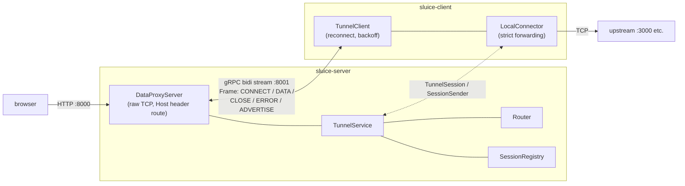
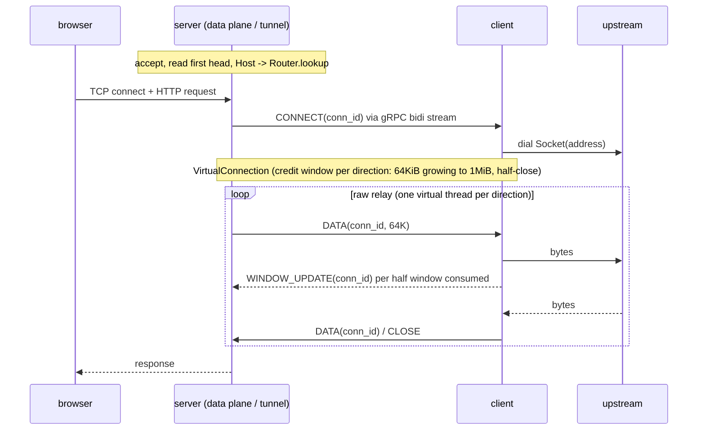
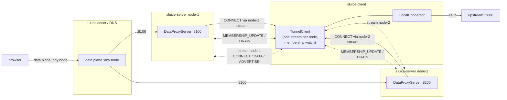

# sluice

HTTP tunnel over a gRPC bidirectional stream, built on Spring Boot 4.1 and Spring gRPC.

A single gRPC bidi stream multiplexes virtual TCP connections (`conn_id`). The data plane is a raw TCP proxy: the request head is inspected for routing (Host / :authority), so WebSocket upgrades and HTTP keep-alive pass through transparently. All blocking I/O runs on virtual threads; outbound frames are scheduled, not merely queued: control frames go first, connection frames wait on a per-connection bounded queue drained round-robin, and gRPC flow control is honored. Each virtual connection has its own credit window per direction (64KiB, grown up to 1MiB against a node-wide budget), so a connection whose reader stalls holds back only its own writer, never the stream.

## Architecture





- one bidi stream per client; each proxied TCP connection becomes a `conn_id` on that stream
- server: accept, route by `Host`, `VirtualConnection` + `CONNECT`, then raw relay (`SocketRelay`, one virtual thread per direction)
- client: `CONNECT`, dial the local upstream (strict forwarding), same raw relay; upstream URLs with `https://` are dialed with TLS (trust-all)
- flow control: bounded queues end to end; the gRPC send path honors `isReady()` on a dedicated sender thread, sends control frames before connection frames, and drains the per-connection queues round-robin so one busy connection cannot starve the others
- per-connection flow control (credit windows, as in HTTP/2 streams): the server and sluice-client announce a 64KiB receive window per connection (`Advertise` / `Connect`; sluice-wasmlet a fixed 1MiB), and a writer sends only against the credit its peer granted with `WINDOW_UPDATE`. The receive path never blocks, so one stalled connection does not stall the others on the stream; a peer sending past its credit fails only that connection. A receiver decides its window at every half window its reader took: a writer that runs out of credit says so (`WINDOW_UPDATE` with `blocked`), and the window doubles, up to 1MiB, when that happened while the reader kept up; it halves, granting back less than was read, when the writer was blocked but the reader never found its buffer empty and is a quarter of the window behind, or when the writer was not blocked for two decisions in a row. The part of a window past 64KiB is charged to the node's tunnel budget (`sluice.limits.tunnel-budget` / `sluice.client.tunnel-budget`) before the grant raising it leaves, within a share of the budget, and released as the window shrinks; a reader idle for 1s asks its peer to give back the credit past 64KiB (`reclaim_above`, answered with `released`), and the remote's end releases all but what is buffered. Bounds: a receiver buffers at most 64KiB per connection plus the budget in total (the number of connections is capped, see "Connection limits"); and one connection has at most one window in flight, so its throughput is at most window / RTT: about 50MiB/s at a 20ms tunnel round trip at the full 1MiB, about 3MiB/s at 64KiB. A peer without the window is refused: the server fails the tunnel stream of a client announcing none with `FAILED_PRECONDITION` (sluice-client 046cd21 / sluice-wasmlet f76388d or later required), and the client and the wasmlet answer a CONNECT without one with an ERROR for that connection (sluice-server 046cd21 or later required); each rejection is logged once
- transport flow control: the server and sluice-client announce a fixed HTTP/2 window (connection and stream alike) for the gRPC connection carrying the tunnel, twice the node's tunnel budget and at least 1MiB, which turns gRPC's own window tuning off; both log it at startup (`gRPC flow control window`). The connections' windows bound what may be in flight, so the transport window only stays out of their way. It does not widen what a receiver may hold: what gRPC buffers before the connections take it was sent against their windows, which the budget charges from the grant on (measured mid-transfer: 32 downloads at about 1GB/s held about 9MiB more direct memory on the receiving server than idle, with 30MiB of windows charged). Left to gRPC, the window started at 1MiB and grew only when one round trip carried more than half of it; as gRPC grants a window back only at every half of it read, a transfer could settle with half the window in flight and half read but not granted back, and the tuning never grew it: in a frame log of such a stack, the whole tunnel moved 512KiB per round trip, about 20MiB/s at a 20ms tunnel round trip, however many connections shared it. Twice the budget leaves the budget's worth in flight even then. In `TunnelTransportWindowE2ETest` 48 downloads, and 48 uploads, through one tunnel move 48MiB per round trip (round trips counted by a proxy holding the receiver's answers back, not timed), where gRPC's tuning moved at most 1.9MiB. sluice-wasmlet keeps hyper's windows (2MiB per stream, 5MiB per connection) for what it receives

## Modules

- `sluice-proto` - `.proto` contract, generated stubs, and the shared tunnel primitives (`VirtualConnection`, `SessionSender`, `SocketRelay`)
- `sluice-server` - exit node: gRPC control plane (`spring.grpc.server.port`, default 8001) + raw TCP data plane (`sluice.data-port`, default 8000) + actuator and management console (`server.port`, default 8081)
- `sluice-client` - tunnel client: connects to the server, advertises upstreams, dials local upstreams on CONNECT, reconnects with jittered exponential backoff (ceiling 1s..30s, each wait drawn from its upper half), actuator on `server.port` (default 9001)
- `sluice-it` - full stack integration tests running the real server and client applications in one JVM (proxying, reconnect after server restart, wrong-token rejection)
- `sluice-example-upstream` - minimal sample upstream for manual checks (`It works` over http/1.1 and h2c)

## Build

```
./mvnw verify
```

Requires JDK 25+. The `sluice-it` classes run in 6 JVMs at once (`-Dsluice.it.forks=N` to
change), a class at a time in each.

Build the executable jars first (the `-exec.jar` files below are produced by this):

```
./mvnw -DskipTests package
```

## Run

```
# terminal 1: upstream (sample server speaking http/1.1 and h2c on one port)
java -jar sluice-example-upstream/target/sluice-example-upstream-0.0.1-SNAPSHOT-exec.jar 31080

# terminal 2: server
java -jar sluice-server/target/sluice-server-0.0.1-SNAPSHOT-exec.jar \
  --sluice.token=SECRET

# terminal 3: client
java -jar sluice-client/target/sluice-client-0.0.1-SNAPSHOT-exec.jar \
  --sluice.server-url=grpc://127.0.0.1:8001 \
  '--sluice.client.upstream[0]'.host=demo.local \
  '--sluice.client.upstream[0]'.target=http://127.0.0.1:31080 \
  --sluice.token=SECRET

# terminal 4: request through the tunnel (routed by the Host header / :authority)
curl -H 'Host: demo.local' http://127.0.0.1:8000/
curl --http2-prior-knowledge -H 'Host: demo.local' http://127.0.0.1:8000/
```

`sluice.server-url` schemes: `grpc://` (plaintext) / `grpcs://` (TLS; `--sluice.insecure=true` skips
verification). For mutual TLS set `sluice.tls-bundle` to a `spring.ssl.bundle.pem.*` bundle whose
keystore holds the client certificate and whose truststore holds the CA of the server certificate;
on the server side pair `spring.grpc.server.ssl.bundle` with `spring.grpc.server.ssl.client-auth=REQUIRE`
and a truststore with the CA of the client certificates.

### Native image (client / server)

GraalVM native images (require a GraalVM JDK; AOT processing and `native-image` run in
the `package` phase):

```
./mvnw -pl sluice-client -am -Pnative -DskipTests package
./mvnw -pl sluice-server -am -Pnative -DskipTests package
sluice-client/target/sluice-client --sluice.server-url=grpc://127.0.0.1:8001 ...
sluice-server/target/sluice-server --sluice.token=SECRET ...
```

TLS termination on the data port (same upstream / server / client):

```
# self-signed cert registered as an SSL bundle, then restart the server with
#   --sluice.data-tls-bundle=data-plane
#   --spring.ssl.bundle.pem.data-plane.keystore.certificate=cert.pem
#   --spring.ssl.bundle.pem.data-plane.keystore.private-key=cert-key.pem
openssl req -x509 -newkey rsa:2048 -keyout cert-key.pem -out cert.pem -days 1 -nodes -subj /CN=localhost

# h2 over TLS (ALPN) / http/1.1 fallback / plaintext on the same port
curl --http2 -k -H 'Host: demo.local' https://127.0.0.1:8000/ -v -o /dev/null 2>&1 | grep 'using HTTP/2' -A2
curl --http1.1 -k -H 'Host: demo.local' https://127.0.0.1:8000/
```

TLS passthrough routed by SNI: see "SNI routing" below.

### Pre-built Docker images

Multi-arch (amd64 / aarch64) JVM and native images are published to ghcr.io on every push to
`main`: `ghcr.io/making/sluice/sluice-server:{jvm,native}` and
`ghcr.io/making/sluice/sluice-client:{jvm,native}` (immutable `jvm_<sha>` / `native_<sha>` tags too).

```
docker run --rm --pull always --name sluice-server -p 8000:8000 -p 8001:8001 -p 8081:8081 \
  ghcr.io/making/sluice/sluice-server:native --sluice.token=SECRET

docker run --rm --pull always --name sluice-client \
  -e SLUICE_SERVER_URL=grpc://host.docker.internal:8001 \
  -e SLUICE_TOKEN=SECRET \
  -e SLUICE_CLIENT_UPSTREAM_0_HOST=demo.local \
  -e SLUICE_CLIENT_UPSTREAM_0_TARGET=http://host.docker.internal:31080 \
  ghcr.io/making/sluice/sluice-client:native

curl -H 'Host: demo.local' http://127.0.0.1:8000/
```

Relaxed binding maps `SLUICE_SERVER_URL` / `SLUICE_TOKEN` /
`SLUICE_CLIENT_UPSTREAM_0_HOST` / `SLUICE_CLIENT_UPSTREAM_0_TARGET` to the properties above
(`host.docker.internal` reaches ports published on the host).

## TCP port routing

Upstreams with `listen-port` are routed by the listen port instead of the connection
head: the server opens one listener per advertised port and relays every accepted
connection verbatim -- no head parsing, no rewriting -- so any TCP protocol (ssh,
postgres, redis, ...) tunnels through, not just HTTP. Such an upstream is reached only
through its port: its `host` takes no part in Host / SNI routing on the data port, so it
neither captures http traffic for that host nor becomes the catch-all when empty.

```
# terminal 1: any TCP server, e.g. redis
redis-server --port 6379

# terminal 2: server (listeners bind on the data host)
java -jar sluice-server/target/sluice-server-0.0.1-SNAPSHOT-exec.jar \
  --sluice.token=SECRET

# terminal 3: client; the upstream target is a tcp:// URL
java -jar sluice-client/target/sluice-client-0.0.1-SNAPSHOT-exec.jar \
  --sluice.server-url=grpc://127.0.0.1:8001 \
  '--sluice.client.upstream[0]'.host=redis.local \
  '--sluice.client.upstream[0]'.target=tcp://127.0.0.1:6379 \
  '--sluice.client.upstream[0]'.listen-port=16379 \
  --sluice.token=SECRET

# terminal 4: connect to the advertised port
redis-cli -p 16379 ping
# -> PONG
```

The listener is bound when the client advertises and released on disconnect; the
server acknowledges the advertisement and reports back the listen ports it could
not bind (outside `sluice.tcp-port-range`, held by another connected client, or
already taken) -- the client keeps the stream (its other routes stay up) and
re-advertises on it with the same jittered backoff (ceiling 1s..30s) until the ports bind. The listen ports
must be exposed on the host (`docker -p`, firewall) -- the deployment delta against
the single data port.

## SNI routing

Where TCP port routing keys on the listen port, these two variants route a TLS
connection by the server name of its ClientHello:

- **TLS passthrough** (`sluice.client.upstream[n].tls-passthrough=true`): the data
  plane relays the TLS bytes untouched and routes by the ClientHello SNI; the upstream
  terminates TLS and presents its own certificate. The upstream target is a plain
  `tcp://` URL — the tunneled bytes are the already-encrypted TLS records.
- **TLS termination** (the default): the data plane terminates TLS (an SSL bundle via
  `sluice.data-tls-bundle` is required) and falls back to the SNI host name when the
  decrypted stream carries no HTTP `Host` header (any protocol works, e.g. RESP); the
  upstream target is then an everyday plaintext `tcp://` / `http://` URL.

Passthrough example, all four terminals:

```
# terminal 1: a TLS upstream (any TLS server works; here openssl's demo server
#   serving the current directory over HTTPS)
echo 'it-works-sni' > index.html
openssl req -x509 -newkey rsa:2048 -keyout cert-key.pem -out cert.pem -days 1 -nodes -subj /CN=demo.local
openssl s_server -accept 34443 -cert cert.pem -key cert-key.pem -WWW

# terminal 2: server (no TLS configuration on the data port)
java -jar sluice-server/target/sluice-server-0.0.1-SNAPSHOT-exec.jar \
  --sluice.token=SECRET

# terminal 3: client; tls-passthrough relays the TLS records as-is
java -jar sluice-client/target/sluice-client-0.0.1-SNAPSHOT-exec.jar \
  --sluice.server-url=grpc://127.0.0.1:8001 \
  '--sluice.client.upstream[0]'.host=demo.local \
  '--sluice.client.upstream[0]'.target=tcp://127.0.0.1:34443 \
  '--sluice.client.upstream[0]'.tls-passthrough=true \
  --sluice.token=SECRET

# terminal 4: request by SNI; --resolve sends ClientHello server_name=demo.local
#   to the data port
curl -k --resolve demo.local:8000:127.0.0.1 https://demo.local:8000/index.html
# -> it-works-sni
```

## Configuration (server)

| Property | Default | Description |
|---|---|---|
| `sluice.token` | (unset = auto-generated; the generated token is written to a temporary file whose path is logged) | bearer token for tunnel clients (`Authorization: Bearer <token>`, constant-time compare) |
| `sluice.token-file` | - | read the token from a file |
| `sluice.data-host` | `0.0.0.0` | bind address of the data plane |
| `sluice.data-port` | `8000` | data plane port |
| `sluice.data-tls-bundle` | - | SSL bundle name for data plane TLS termination (h2 / http/1.1 via ALPN, `force-http1` flips the preference); unset = plaintext only (TLS connections are served by upstreams with `tls-passthrough=true`) |
| `sluice.ca-bundle` | - | SSL bundle whose keystore holds the CA private key + certificate; enables client certificate issuance in the console (the signed certificates authenticate against the gRPC `client-auth=REQUIRE` truststore, no restart) |
| `sluice.proxy-protocol` | `false` | parse the PROXY protocol (v1 / v2) header an SNAT front end prepends on the data plane: the header is consumed before routing / relay (never forwarded) and its source address becomes the connection peer for access control and the access log; headerless connections are unaffected, a malformed header fails the connection |
| `sluice.limits.max-connections` | `0` = `connection-memory` / 293KiB | connections open at once over the data port and every tcp route port (an h2 connection takes one more slot per further upstream connection open at once); see "Connection limits" |
| `sluice.limits.connection-memory` | `0` = half the max heap less the h2 queue budget, the tunnel budget and 256KiB per overflow connection; unbounded when `max-connections` is set | bytes the data plane's connections may reserve for their worst-case buffering outside the budgets: 293KiB per connection, 1127KiB more per h2 connection, 792KiB per further upstream connection of an h2 connection; see "Connection limits" |
| `sluice.limits.tunnel-budget` | `0` = an eighth of half the max heap | bytes the tunnel connections may buffer beyond each connection's allowance, shared by all of them: the receive windows grown past 64KiB (up to 1MiB each) and the frames a connection queues for the tunnel stream past one; twice it (at least 1MiB) is the gRPC flow control window; see "Connection limits" |
| `sluice.limits.overflow-connections` | `8` | data port connections past the connection limit answered `503` at once instead of closed at accept; `0` = every one closed at accept; see "Connection limits" |
| `sluice.limits.overflow-timeout` | `5s` | one deadline from accept for all of an overflow connection (TLS handshake, request head, answer); see "Connection limits" |
| `sluice.limits.overflow-retry-after` | `5s` | the `Retry-After` of the `503` answering an overflow connection, in whole seconds |
| `sluice.limits.max-connections-per-address` | `0` = no limit beyond `max-connections` | connections open at once from one source address (the PROXY protocol source with `proxy-protocol=true`, the socket peer otherwise) |
| `sluice.limits.head-timeout` | `10s` | one deadline for the whole head phase of a data plane connection (PROXY header, TLS handshake, request head); on plaintext and TLS-terminated HTTP/1.1 it also bounds a later request head left incomplete between requests |
| `sluice.limits.idle-timeout` | `60s` | how long a plaintext or TLS-terminated HTTP connection may idle between requests (h2: with no stream open) before it is closed; see "Connection limits" |
| `sluice.limits.stall-timeout` | `60s` | how long a request or response in flight on a plaintext or TLS-terminated HTTP connection (HTTP/1.1 or h2) may wait on its client without progress before the connection is closed; see "Connection limits" |
| `sluice.limits.stall-min-bytes` | `16KB` | the bytes moved to or from the client that count as progress against `stall-timeout` (`1B`: every byte counts) |
| `sluice.limits.verbatim-idle-timeout` | `0` = off | how long a connection relayed verbatim (TLS passthrough, tcp route, hostless, upgraded HTTP/1.1) may relay no byte in either direction before it is closed, for the routes whose upstream sets no `verbatim-idle-timeout`; see "Connection limits" |
| `sluice.limits.tunnel-stall-timeout` | `60s` | how long a tunnel stream may hold frames queued for its client while not ready, the client taking none of them, before the session is failed; `0` = off; see "Connection limits" |
| `sluice.limits.half-close-probe-interval` | `1s` | quiet after which a plaintext or TLS-terminated HTTP connection whose client ended its side, a response owed, gets a probe to learn whether the client is gone: HTTP/1.1 a `100 Continue`, h2 a PING; `0` = off; see "Connection limits" |
| `sluice.limits.advertise-timeout` | `10s` | how long a tunnel stream may go without the client's first `Advertise` before it is failed with `DEADLINE_EXCEEDED`; see "Connection limits" |
| `sluice.limits.max-pending-tunnel-streams` | `256` | tunnel streams whose client has not sent its first `Advertise` yet, at once; a stream beyond it is failed at once with `RESOURCE_EXHAUSTED`; see "Connection limits" |
| `sluice.limits.max-pending-tunnel-streams-per-address` | `0` = no limit beyond `max-pending-tunnel-streams` | the same from one source address (the gRPC peer) |
| `sluice.limits.max-tunnel-sessions` | `1024` | tunnel clients registered at once on the node (sessions whose client advertised); a stream of a new client id beyond it is failed with `RESOURCE_EXHAUSTED`; see "Connection limits" |
| `sluice.limits.max-tunnel-sessions-per-address` | `0` = no limit beyond `max-tunnel-sessions` | the same from one source address (the gRPC peer) |
| `sluice.limits.h2-queue-budget` | `0` = an eighth of half the max heap | bytes the h2 demux relays may hold, both ways, beyond each connection's allowance, plus the connection window their clients and upstreams hold past 65535 bytes, shared by all of them; a window grows past 65535 bytes only as far as this takes it, and a connection whose share of it reaches 2MiB is granted no more window; see "Connection limits" |
| `sluice.limits.h2-stream-wait-timeout` | `30s` | how long an h2 stream may wait for a place within its upstream's `SETTINGS_MAX_CONCURRENT_STREAMS` before it is refused with `REFUSED_STREAM`; `0` = off; see "Connection limits" |
| `sluice.tcp-port-range` | (unset = any port) | listen ports a client may claim for tcp routes, comma separated single ports or `min-max` ranges (e.g. `9000-9010,8080`); a port outside the range is not bound |
| `sluice.http-load-balance` | `smallest-client-id` | target picked when several clients serve the same domain: `smallest-client-id` (deterministic across nodes) / `round-robin` (per node) / `random` |
| `sluice.tcp-load-balance` | `smallest-client-id` | target picked for tcp routes when several clients serve the same listen port (same values); the listen port bind itself always follows the smallest client id |
| `sluice.node.id` | hostname | cluster node id (logs, metrics, membership) |
| `sluice.node.public-url` | - | control plane address clients use for this node (e.g. `grpcs://sluice-0.example.com`); empty = reachable at the bootstrap address only |
| `sluice.cluster.nodes` | (empty = single-node) | cluster members, `nodeId=publicUrl` entries; see "Cluster (scale-out)" |
| `sluice.cluster.warmup` | `10s` | readiness stays down this long after start |
| `sluice.cluster.drain-grace` | `10s` | wait for in-flight virtual connections during drain |
| `sluice.cluster.membership-poll` | `10s` | membership re-read interval (pushed to clients on change) |
| `sluice.access-log.enabled` | `true` | emit access logs to the `sluice.access` logger (logfmt, INFO) |
| `sluice.access-log.types` | `connection,request` | comma separated event types: `connection` (accept/close with route, transport, bytes, duration) / `request` (every request head -- method, path, HTTP version, and the route it resolved to; on plaintext HTTP/1.1 keep-alive connections each request is parsed and routed, so a connection hopping hosts logs one `request` line per request) |
| `sluice.access-log.rate-limit.enabled` | `true` | rate limit access log lines per line kind, syslog style (as in `rate-limited-logger`) |
| `sluice.access-log.rate-limit.max-rate` | `10` | max lines emitted per line kind (`conn-accept` / `conn-close` / `conn-reject` / `request`) within one period; the line that reaches the limit is still emitted |
| `sluice.access-log.rate-limit.period` | `10s` | rate limit window; lines beyond the limit are counted and one `type=ratelimit` summary line reports the suppressed count when the period rolls over |
| `sluice.access-control.allow-cidrs` | (empty = every address) | data plane IP allow list, literal IPv4/IPv6 CIDRs or bare addresses; denied connections get 403 (http routes) or a plain close (tcp routes / TLS passthrough) |
| `sluice.access-control.deny-cidrs` | (empty) | data plane IP deny list, evaluated before any allow list and never overridden |
| `sluice.access-control.trusted-proxy-cidrs` | (empty = the peer address is judged) | peers trusted as proxying load balancers: when the connection peer matches, the rightmost `X-Forwarded-For` entry (the one the proxy appended) is judged instead of the peer address; the LB must be configured to append to the header, client-sent entries stay part of the chain |
| `spring.grpc.server.port` | `8001` | gRPC control plane port |
| `server.port` | `8081` | actuator (health / info / prometheus) and the management console (`/console`) |
| `sluice.console.auth.type` | `simple` | console authentication: `simple` (form login with `spring.security.user.name` / `spring.security.user.password`) / `oidc` (OpenID Connect via `spring.security.oauth2.client.*`; see "Console authentication") |

## Configuration (client)

| Property | Default | Description |
|---|---|---|
| `sluice.server-url` | - | tunnel server endpoint (`grpc://host:port` / `grpcs://host:port`) |
| `sluice.client.id` | random, once per process | stable client identity sent as `x-sluice-id` on every stream; breaks route / listen-port ties in cluster mode |
| `sluice.client.max-connections` | `0` = (half the max heap - `tunnel-budget`) / 293KiB | upstream connections open at once over every server node; a `CONNECT` beyond it is answered with an ERROR without dialing |
| `sluice.client.tunnel-budget` | `0` = an eighth of half the max heap | bytes the client's connections may buffer beyond each connection's allowance, shared by all of them, as `sluice.limits.tunnel-budget` on the server (twice it, at least 1MiB, is the gRPC flow control window) |
| `sluice.client.tunnel-stall-timeout` | `60s` | how long a tunnel stream may hold frames queued for the server while not ready, the server taking none of them, before the stream is cancelled and reconnected; `0` = off; see "Connection limits" |
| `sluice.client.upstream[n].host` | - | public domain routed by the server (empty = catch-all) |
| `sluice.client.upstream[n].host-pattern` | - | regular expression the request host (without its port) is matched against, whole match; tried after the exact matches, before the catch-all, in natural order; overrides `host` when set |
| `sluice.client.upstream[n].target` | - | upstream URL: `http://` (default when the scheme is omitted), `https://` (TLS terminated by the client), or `tcp://` (raw relay, e.g. a TLS endpoint in passthrough mode) |
| `sluice.client.upstream[n].rewrite-host` | `false` | rewrites the request Host / `:authority` to the target's `host[:port]` |
| `sluice.client.upstream[n].tls-passthrough` | `false` | TLS connections for the upstream are relayed untouched (routed by ClientHello SNI, the upstream terminates TLS) instead of terminated on the data plane |
| `sluice.client.upstream[n].force-http1` | `false` | the upstream speaks HTTP/1.1 only: the data plane's TLS termination prefers http/1.1 in ALPN for the route, and an h2 stream for it (a browser coalescing the host onto an h2 connection of another host, an h2-only or h2c client) gets `421 Misdirected Request`; `tls-passthrough` routes are unaffected |
| `sluice.client.upstream[n].listen-port` | `0` | public port the server listens on for this upstream; connections are relayed as raw TCP routed by the listen port -- no head parsing, no rewriting -- so any protocol (ssh, postgres, redis, ...) tunnels through. The listener is bound on advertise and released on disconnect; bind it on the host (`docker -p`, firewall) to expose it |
| `sluice.client.upstream[n].allowed-cidrs` | (empty = the server-wide `sluice.access-control.allow-cidrs` applies) | CIDRs / bare addresses allowed to connect to this upstream on the data plane; replaces the server-wide allow list for the route (the deny list still applies) |
| `sluice.client.upstream[n].verbatim-idle-timeout` | `0` = the server's `sluice.limits.verbatim-idle-timeout` applies | how long a connection of this upstream relayed verbatim (TLS passthrough, tcp route, hostless, upgraded HTTP/1.1) may relay no byte in either direction before the server closes it; replaces the server's default for the route; see "Connection limits" |
| `sluice.token` / `sluice.token-file` | - | authentication token |
| `sluice.insecure` | `false` | skip TLS verification |
| `sluice.tls-bundle` | - | SSL bundle for the `grpcs://` control plane connection: keystore = client certificate (mutual TLS), truststore = CAs to verify the server; takes precedence over `sluice.insecure` |
| `sluice.keep-alive-time` | `30s` | interval of the gRPC keepalive ping towards the server |
| `sluice.keep-alive-timeout` | `10s` | how long a keepalive ping answer may take before the channel is torn down |
| `sluice.strict-forwarding` | `true` | only dial upstreams present in the map |
| `server.port` | `9001` | actuator (health / info / prometheus) |

## gRPC keepalive

The tunnel is one long-lived gRPC stream; NAT / load balancers silently drop idle
connections, so both sides keep it warm with HTTP/2 pings and the server-side values are
set explicitly in `sluice-server/src/main/resources/application.properties`:

| Setting | Value | Reason |
|---|---|---|
| server `spring.grpc.server.keepalive.time` / `spring.grpc.server.keepalive.timeout` | `30s` / `10s` | the server pings clients and reaps dead ones (session and routes released ~40s after silent death) |
| server `spring.grpc.server.keepalive.permit.time` / `spring.grpc.server.keepalive.permit.without-calls` | `10s` / `true` | client pings every 30s; grpc's default permit (5m) risks `GOAWAY TOO_MANY_PINGS` |
| client `sluice.keep-alive-time` / `sluice.keep-alive-timeout` | `30s` / `10s` | pings keep NAT mappings alive; an unanswered ping tears the channel down and the reconnect backoff (ceiling 1s..30s, jittered) takes over |

Application-level `KEEPALIVE` frames are not sent: the gRPC (HTTP/2) ping already
provides liveness. The frame type stays in the proto for future use and is handled as a
no-op on both sides. `GrpcKeepAliveTest` (sluice-it) guards the behavior with a 1s-ping
channel.

## Cluster (scale-out)

Run N server nodes: every client keeps one tunnel stream to every node, so each node holds
the full route table locally -- no shared store, no inter-node hop.

Deployment requirements (independent of the front end):

- each node's control plane is reachable from clients at its own address (per-node URL)
- data plane connections may land on any node (plain L4 balancing is enough)

```
# terminal 1/2: two nodes sharing one membership list and token
java -jar sluice-server/target/sluice-server-0.0.1-SNAPSHOT-exec.jar \
  --sluice.token=SECRET --sluice.node.id=node-1 \
  --spring.grpc.server.port=8101 --sluice.data-port=8100 --server.port=18180 \
  --sluice.cluster.nodes=node-1=grpc://127.0.0.1:8101,node-2=grpc://127.0.0.1:8201
java -jar sluice-server/target/sluice-server-0.0.1-SNAPSHOT-exec.jar \
  --sluice.token=SECRET --sluice.node.id=node-2 \
  --spring.grpc.server.port=8201 --sluice.data-port=8200 --server.port=18181 \
  --sluice.cluster.nodes=node-1=grpc://127.0.0.1:8101,node-2=grpc://127.0.0.1:8201

# terminal 3: client -- server-url is only the bootstrap; the node list is learned
# via ListNodes and one stream is opened per node
java -jar sluice-client/target/sluice-client-0.0.1-SNAPSHOT-exec.jar \
  --sluice.server-url=grpc://127.0.0.1:8101 --sluice.client.id=client-1 \
  '--sluice.client.upstream[0]'.host=demo.local \
  '--sluice.client.upstream[0]'.target=http://127.0.0.1:31080 \
  --sluice.token=SECRET

# terminal 4: either node serves the route
curl -H 'Host: demo.local' http://127.0.0.1:8100/
curl -H 'Host: demo.local' http://127.0.0.1:8200/
```



Each node routes with its own full copy of the route table (every client advertises to
every node), so the data plane never hops between nodes.

Behavior:

- membership: `sluice.cluster.nodes` lists the members as `nodeId=publicUrl` entries (the
  local node is always included). It is pushed to every client once it advertised and whenever it
  changes (`MEMBERSHIP_UPDATE` frame); the client opens/closes per-node streams accordingly.
  A node with an empty public url is reachable at the address the client bootstrapped with
- routing: a domain (or listen port) claimed by several clients is served by the one with
  the smallest `sluice.client.id` -- deterministically on every node, since every node sees
  every client. A smaller id takes over a bound listen port on advertise; a larger id gets
  the port rejected and retries on the same stream
- lifecycle: readiness (`/actuator/health/readiness`) is DOWN for `sluice.cluster.warmup`
  after start (clients connect first) and while draining. On shutdown the node sends a
  `DRAIN` frame, waits up to `sluice.cluster.drain-grace` for in-flight virtual connections
  to finish, then closes the streams. Clients keep their other nodes' streams and retry the
  drained node with backoff
- configuration: cluster mode refuses to start without an explicit `sluice.token` /
  `sluice.token-file` (per-node random tokens would break clients connected to every node)
- observability: every metric carries a `node` common tag; the client health details show
  the per-node stream states

Without `sluice.cluster.nodes` the server runs single-node and nothing above applies
(`ListNodes` returns just the node itself).

## Cluster (TLS)

The control plane can serve TLS (`spring.grpc.server.ssl.bundle`), so a front end routes
per node by SNI without terminating TLS. Verified end to end with a self-signed certificate;
no code difference from the plaintext cluster, only configuration:

```
# self-signed cert for the gRPC control plane
openssl req -x509 -newkey rsa:2048 -keyout grpc-key.pem -out grpc-cert.pem -days 1 -nodes -subj /CN=localhost

# terminal 1/2: same cluster as above, plus the TLS bundle on every node
java -jar sluice-server/target/sluice-server-0.0.1-SNAPSHOT-exec.jar \
  --sluice.token=SECRET --sluice.node.id=node-1 \
  --spring.grpc.server.port=8101 --sluice.data-port=8100 --server.port=18180 \
  --sluice.cluster.nodes=node-1=grpcs://127.0.0.1:8101,node-2=grpcs://127.0.0.1:8201 \
  --spring.grpc.server.ssl.bundle=grpc-control \
  --spring.ssl.bundle.pem.grpc-control.keystore.certificate=file:grpc-cert.pem \
  --spring.ssl.bundle.pem.grpc-control.keystore.private-key=file:grpc-key.pem
java -jar sluice-server/target/sluice-server-0.0.1-SNAPSHOT-exec.jar \
  --sluice.token=SECRET --sluice.node.id=node-2 \
  --spring.grpc.server.port=8201 --sluice.data-port=8200 --server.port=18181 \
  --sluice.cluster.nodes=node-1=grpcs://127.0.0.1:8101,node-2=grpcs://127.0.0.1:8201 \
  --spring.grpc.server.ssl.bundle=grpc-control \
  --spring.ssl.bundle.pem.grpc-control.keystore.certificate=file:grpc-cert.pem \
  --spring.ssl.bundle.pem.grpc-control.keystore.private-key=file:grpc-key.pem

# terminal 3: client -- grpcs:// bootstrap, insecure trusts the self-signed cert;
# membership URLs (grpcs://) are dialed with the same setting
java -jar sluice-client/target/sluice-client-0.0.1-SNAPSHOT-exec.jar \
  --sluice.server-url=grpcs://127.0.0.1:8101 --sluice.insecure=true --sluice.client.id=client-1 \
  '--sluice.client.upstream[0]'.host=demo.local \
  '--sluice.client.upstream[0]'.target=http://127.0.0.1:31080 \
  --sluice.token=SECRET

# terminal 4: both nodes serve over their TLS control planes
curl -H 'Host: demo.local' http://127.0.0.1:8100/
curl -H 'Host: demo.local' http://127.0.0.1:8200/

# the control plane negotiates h2 via ALPN
echo | openssl s_client -connect 127.0.0.1:8101 -alpn h2 2>/dev/null | grep 'ALPN protocol'
```

E2E coverage: `ClusterGrpcTlsE2ETests` (sluice-it) -- both nodes serve, failover after a
node stops, and h2 negotiation on the TLS endpoint.

## Mutual TLS (server <-> client)

The server requires a client certificate (`client-auth=REQUIRE`) and the client presents one
from an SSL bundle (`sluice.tls-bundle`); no `sluice.insecure` needed. Example with a local CA:

```sh
# a private CA and two leaf certificates signed by it
openssl req -x509 -newkey rsa:2048 -nodes -keyout ca-key.pem -out ca.pem \
  -days 3650 -subj /CN=sluice-ca -addext basicConstraints=critical,CA:TRUE
openssl req -newkey rsa:2048 -nodes -keyout server-key.pem -out server.csr -subj /CN=localhost
openssl x509 -req -in server.csr -CA ca.pem -CAkey ca-key.pem -days 3650 \
  -extfile <(printf 'subjectAltName=DNS:localhost,IP:127.0.0.1\n') -out server-cert.pem
openssl req -newkey rsa:2048 -nodes -keyout client-key.pem -out client.csr -subj /CN=sluice-client
openssl x509 -req -in client.csr -CA ca.pem -CAkey ca-key.pem -days 3650 -out client-cert.pem
openssl verify -CAfile ca.pem server-cert.pem client-cert.pem
```

```sh
# server: terminate TLS on the control plane and require client certificates
java -jar sluice-server/target/sluice-server-0.0.1-SNAPSHOT-exec.jar \
  --sluice.token=SECRET --spring.grpc.server.port=8001 --sluice.data-port=8000 \
  --spring.grpc.server.ssl.bundle=grpc-control \
  --spring.grpc.server.ssl.client-auth=REQUIRE \
  --spring.ssl.bundle.pem.grpc-control.keystore.certificate=file:server-cert.pem \
  --spring.ssl.bundle.pem.grpc-control.keystore.private-key=file:server-key.pem \
  --spring.ssl.bundle.pem.grpc-control.truststore.certificate=file:ca.pem

# client: keystore = the client certificate, truststore = the CA that signed the server cert
java -jar sluice-client/target/sluice-client-0.0.1-SNAPSHOT-exec.jar \
  --sluice.server-url=grpcs://127.0.0.1:8001 --sluice.tls-bundle=grpc-client --sluice.client.id=client-1 \
  '--sluice.client.upstream[0]'.host=demo.local \
  '--sluice.client.upstream[0]'.target=http://127.0.0.1:31080 \
  --spring.ssl.bundle.pem.grpc-client.keystore.certificate=file:client-cert.pem \
  --spring.ssl.bundle.pem.grpc-client.keystore.private-key=file:client-key.pem \
  --spring.ssl.bundle.pem.grpc-client.truststore.certificate=file:ca.pem \
  --sluice.token=SECRET
```

The client bundle is applied to every node connection (the bootstrap and the membership
`grpcs://` URLs alike). `client-auth` also accepts `OPTIONAL` / `WANT` / `NONE`.

E2E coverage: `ClusterGrpcMutualTlsE2ETests` (sluice-it) -- mTLS to both nodes with failover,
rejection of a certificate-less client, a certificate issued through the console
(`sluice.ca-bundle`), and TLS termination / passthrough on the data plane over the mTLS
tunnel.

## Connection limits

The data port and every tcp route port share one limit on the connections open at once
(`sluice.limits.max-connections`) and on the bytes they reserve for their worst-case
buffering (`sluice.limits.connection-memory`), taken at accept: a connection beyond either
is closed unread, but for the overflow below. An h2 connection reserves more once its
protocol is chosen (see below).
`sluice.limits.max-connections-per-address` caps one source address; it is off by
default because behind an SNAT front end without the PROXY protocol every connection
carries the front end's address. `sluice.limits.head-timeout` is one deadline for the
whole head phase (PROXY header, TLS handshake, request head), not a timeout per read, so a
peer dripping its head is cut as well. Rejected connections are logged as rate-limited
`type=conn event=reject` access log lines. The client caps its upstream connections over
every node (`sluice.client.max-connections`): a `CONNECT` beyond it gets an ERROR without a
dial, and the server closes the public connection.

Past the limit, up to `sluice.limits.overflow-connections` (8) data port connections at
once are answered instead of closed unread, so that a client learns the server is busy
rather than seeing a failed TLS handshake or a reset. Each is served under one deadline
counted from accept, `sluice.limits.overflow-timeout` (5s): the TLS handshake of a route
the server terminates (ALPN: http/1.1 when offered, else h2) and the request head, then a
`503` busy page with `Retry-After` (`sluice.limits.overflow-retry-after`, 5s; h2: on the
request's stream, then a GOAWAY `NO_ERROR` naming that stream as the last processed); the
connection is closed once the client closed it, at the deadline at the latest. Closed
unanswered instead: a connection the deadline reaches first, one whose handshake fails or
whose client goes away (its place freed at once), a TLS passthrough connection (the
handshake is the upstream's, nothing the server could answer in) and a head that is no
HTTP request, an h2 head that cannot be decoded included. With `sluice.proxy-protocol=true`
the PROXY header (v1 or v2) comes first on an overflow connection too: the answer follows
it, its access log reject line carries the PROXY source address, and a malformed header
closes the connection unanswered. Past the overflow, a connection is closed at accept as before, and tcp
route ports have no overflow. An overflow connection holds no slot and no virtual
connection; the derived connection memory leaves 256KiB for each, its ClientHello and its
head each read into a buffer of up to 128KiB (the TLS engine's records are not counted).
A flood past the limit holds each place for the overflow timeout at most, and the
connections past the places are closed at accept, as with `overflow-connections=0`.
Overflow connections count as `rejected` with `reason=limit` like those closed at accept;
the answered ones also as `sluice.data.connections.overflow.answered` (`protocol` = `h1` /
`h2`), and their access log reject line carries `transport` and `status=503`.
`sluice.data.connections.overflow` gauges the places taken.

A plaintext or TLS-terminated HTTP connection idle between requests is closed after
`sluice.limits.idle-timeout`, releasing its slot: HTTP/1.1 once every response is relayed
and nothing of a next request has arrived (a next request head left incomplete is then cut
by `head-timeout`), h2 once no stream is open (with a GOAWAY `NO_ERROR` naming the highest
stream the client opened; PINGs do not count as activity, and a stream the relay answers
itself starts the timeout over). A response or h2 stream taking longer than the timeout is
not cut, nor is an upgraded connection (WebSocket; a connection whose upgrade the upstream
declines stays HTTP). An idle h2 connection whose client stopped reading (it floods PINGs,
say) is closed under the relay's blocked write after the one-second teardown grace.
Behind a front end that reuses its connections to the data plane, set the timeout above
the front end's idle timeout, so the front end closes an idle connection before sluice
does. Connections closed so count as
`sluice.data.connections.idle.closed`.

While a request or response is in flight on such a connection,
`sluice.limits.stall-timeout` bounds the time the relay waits on the client without
`sluice.limits.stall-min-bytes` moving to or from it (the counterpart of nginx
`send_timeout` / `client_body_timeout`, with a minimum rate): a write to the client not
completing (it does not read), h2 response DATA (a page the relay answers itself
included) waiting for a window the client does not grant (its connection window, or the
stream window of a response begun), or a request
body that is due and not sent -- an HTTP/1.1 body announced by `Content-Length` or
chunked, an h2 stream not ended by the client while it holds window to send it. A client
dripping bytes below the minimum is cut as if it sent none. The connection is closed (h2:
GOAWAY `ENHANCE_YOUR_CALM` first) and counted as `sluice.data.connections.stall.closed`.
Waiting for an upstream does not count: a slow or long-polling response, an upload the
upstream does not read yet (h2: the relay grants the client no stream window meanwhile),
h2 uploads whose connection window the relay withholds for want of budget once the client
spent it. Nor does a client awaiting a `100 Continue` it asked for (until a response head
or a byte of its body), an h2 request while its response is in progress (a streaming
exchange), or an h2 CONNECT stream (a tunnel). The time waited is checked eight times per
timeout, so a stall is cut up to a quarter of the timeout past it. Write progress is what
the client's TCP stack accepts: once the buffers towards a client that reads slowly have
filled up, a blocked write may return long after the client resumed reading (observed on
Linux loopback: only once the client drained about 900KB), so keep the timeout well above
such gaps. The relay writes in 16KiB pieces, each counted as progress once it completes;
on h2, DATA read from the client counts as progress too. A client streaming small pieces
(a gRPC client stream) slower than the minimum is cut too: set `stall-min-bytes=1B` to
count every byte, or raise the timeout. Connections relayed verbatim keep no stall
timeout; see the verbatim idle timeout below.

A connection relayed verbatim -- TLS passthrough, a tcp route, a hostless connection (a
RESP head, plaintext or TLS-terminated), an upgraded HTTP/1.1 connection (a WebSocket,
say) -- has no request boundaries, so neither `idle-timeout` nor `stall-timeout` applies
to it. It is bounded by the verbatim idle timeout instead: once no byte was read from the
client nor written to it for the timeout, the connection is closed, its slot released, and
counted as `sluice.data.connections.verbatim.idle.closed`. Bytes flowing in one direction
keep it open. A connection half-closed by its upstream stays under the timeout, as does
one whose client stopped reading: the relay's write to it blocks, nothing more is written,
and the timeout closes the connection under the blocked write (a TLS-terminated one after
the one-second teardown grace, should the relay's teardown wait on that write). A write
counts as each of its 16KiB pieces completes. What idles legitimately depends on the
protocol (a Redis or database pool keeps connections idle for minutes), so the timeout is
set per route by the client operator, `sluice.client.upstream[n].verbatim-idle-timeout`;
`sluice.limits.verbatim-idle-timeout` applies to the routes that set none, so a server
operator can bound every route. A route's own timeout replaces the server's, longer or
shorter; a route cannot turn the server's off. Both are off by default: a peer that goes
quiet on a connection relayed verbatim, or stops reading from it, then holds its slot of
`max-connections` (and of `max-connections-per-address`) until it or the upstream closes
the connection.

The plaintext and TLS-terminated HTTP/1.1 relay reads request and response heads as
ISO-8859-1, so a field value carrying non-ASCII bytes (a UTF-8 header value, RFC 9110
obs-text) is routed, rewritten and tracked like any other, its bytes relayed as is. A
request it cannot follow is malformed: a head over 64KiB, a line not ended by CRLF, a bare
CR, a NUL, a malformed request line, a field line folded, whose name is not a token
(whitespace before the colon included) or whose value holds a control character other
than HTAB, more than one `Host`, a `Content-Length` that
is not one decimal number, a `Transfer-Encoding` whose final coding is not `chunked` or that
comes with a `Content-Length`, and a chunk-size line, chunk terminator or trailer section
out of the chunked syntax. Since the upstream might frame such bytes differently (request
smuggling), nothing of the malformed request or after it is relayed: once the responses to
the requests before it are relayed, the client gets `400 Bad Request` -- unless the
upstream already began answering the malformed request on its head -- and the connection is
closed, after reading what the client still sends for up to 2s, so the 400 is not lost to
a reset. A first request head with a `Host` header but no valid request line is
answered 400 too. A response whose framing the relay cannot follow (a head over 64KiB or
without a status code, an invalid `Content-Length` or chunk-size line) is relayed as an
unframed one: it ends, and the connection with it, when the upstream closes.

A client's FIN does not tell whether it half-closed or left: HTTP/1.1 lets a half-closed
client still wait for its response (RFC 9112 9.6), and only a write fails on a client gone.
So once a plaintext or TLS-terminated HTTP/1.1 client ended its side while a response is
owed and none of it relayed, the relay writes `HTTP/1.1 100 Continue` after each
`sluice.limits.half-close-probe-interval` without a write to the client or a request
relayed, at most four per response. A client gone fails the second write: the relay ends,
fails its tunnel connection, and the client closes the upstream connection. A client that
only half-closed reads the 100s, then its response. A gone client is not noticed, and is
held until the upstream answers or closes (for a wasmlet route, its request budget), once
a response has begun (nothing can be added to it), towards an HTTP/1.0 request (which must
not get a 1xx), while a request asking for an upgrade awaits its answer (the relay reads
nothing from the client meanwhile), and after the four probes. `0` turns the probe off.

An h2 client ending its side (its FIN) while a request of its is unfinished -- a stream it
has not ended, which can never complete now -- ends the relay at once. Otherwise the relay
drains: the responses owed are relayed, each upstream connection is closed (a GOAWAY, then
its end) once no stream of it is left, open or waiting for the upstream's concurrency
limit, the request bytes it still held written first, and the client connection once all
its streams completed and every upstream connection closed. Meanwhile the relay writes a
PING to the client after each `half-close-probe-interval` without a write to it: a client
gone fails a write, and the relay ends, its upstream connections with it.

The clients measured (curl, wget, Go, the JDK `HttpClient` and `HttpURLConnection`,
Python's `http.client`, Node's `http` and `fetch`) do not half-close after a request, so a
live client that gets a probe half-closed on purpose (`nc`-style tools). No 1xx suits every
client: Node's `fetch` (undici 7.28) fails on an unsolicited 100, while Python's
`http.client` and `HttpURLConnection` before JDK 20 mishandle a 102 or 103 as the final
response; the others skip a 100 too. Go before 1.24 fails a response at its sixth 1xx and
the JDK `HttpClient` at its ninth, hence four.

What one relayed connection buffers on each side of the tunnel outside the tunnel budget
is its receive buffer at the initial 64KiB window + one frame of its send queue (64KiB) +
the two relay buffers (2 x 64KiB) = 293KiB. The receive buffer holds at most the window of
unread payload, coalesced into 16KiB segments whatever the size of the DATA frames, plus
37KiB: a partly read and a partly filled segment, and the overhead of at most 80 segments
(a 1MiB window's). Past that, a connection's window grown beyond 64KiB (up to 960KiB more)
and its send queue past one frame (up to 15 frames more, 960KiB) take from the tunnel
budget (`sluice.limits.tunnel-budget`, an eighth of half the max heap; the client's
`sluice.client.tunnel-budget` likewise), shared by every connection of the node: a
connection grows only within its share -- the budget over the connections holding part of
it plus one, so they leave room for one more -- and by what the budget has left, and a
send queue past its frame waits for room, its own frames leaving letting it go on. A
connection whose reader stops holds its window but grows no further; one whose budget
share is cut gives back what it can as it drains. So a node's connections buffer at most
293KiB each plus the budget: in `TunnelBudgetE2ETest` eight downloads whose clients stop
reading, and eight uploads to upstreams that stop reading, stay within 8 x 64KiB plus a
2MiB budget at every sample on the server and on the client (not 8 x 1MiB), and the public
client going away, the upstream's reset and the verbatim idle timeout each release what
the window took. The budget's size decides how many connections move at the full window
at once: at a 20ms tunnel round trip a connection at 1MiB moves up to about 50MiB/s, one
at 64KiB about 3MiB/s. The 25.6MiB budget of production's 409MiB heap holds the full
receive window of 26 connections at once (each share above 960KiB), and every other
connection keeps flowing at 64KiB; each MiB of budget costs 3.5 connections of the derived
limit. With room, one connection grows to the full window: an 8MiB download or upload
through a 20ms tunnel round trip takes about 18 waits for credit in
`TunnelBudgetE2ETest`, where 64KiB alone would take 256, and an h2 connection's upstream
connection grows the same way (`H2DemuxWindowRoundTripE2ETest`).

h2 (plaintext and TLS-terminated) is demultiplexed on netty's HTTP/2 codec: the relay
is the HTTP/2 endpoint of the client connection and a client of one upstream connection
-- a virtual connection -- per route the connection reaches: the first on the
connection's own slot of `sluice.limits.max-connections`, each further one open at once on
a slot of its own, reserving its bytes (see below). A stream whose route needs a new
upstream connection while the limit has no slot or bytes left is refused with
`REFUSED_STREAM` (the client may retry it), the connection going on. An upstream connection that closed is let go by the relay and the
tunnel session, and its slot comes back once the frames it queued for the tunnel stream
left the sender. A stream beyond the upstream's
`SETTINGS_MAX_CONCURRENT_STREAMS` (one until the upstream's first SETTINGS) waits in the
relay, for the same upstream connection, until one of the streams there closes; a stream
still waiting after `sluice.limits.h2-stream-wait-timeout` (30s; `0` = off) is refused
with `REFUSED_STREAM`, its upstream never having seen it, so an upstream that keeps its
streams open or announces a limit of 0 does not hold it for good.

The windows are per hop. The relay announces a 1MiB stream window to the client and to
each upstream, grants a stream's window back only for what it wrote on the other hop, and
refills its connection windows as DATA arrives, not as it is written (a connection window
is refilled once half of it is spent): a stream held by its upstream or by its client
holds at most one stream window in the relay, and the connection's other streams go on,
on the same upstream connection too. A connection window starts at RFC 9113's 65535 bytes
and grows with what its peer sends per round trip, up to 1MiB: the relay sends a PING with
the DATA a peer sends and counts the DATA read until the PING's ack (as gRPC's HTTP/2
transport sizes its window), and once a peer sent half its window within that round trip,
the window doubles (128KiB, 256KiB, 512KiB, 1MiB) at its next refill; a client sending
small request bodies, or an upstream a slow stream, keeps 65535 bytes. A peer that does
not answer PINGs keeps 65535 bytes too. So an h2 connection moves at most 1MiB per round
trip of a hop, all its streams together: a download at most 1MiB per tunnel round trip, an upload
at most 1MiB per round trip of the client and at most the upstream's own windows per
tunnel round trip. 1MiB is the most the tunnel's per-connection window grows to: an
upstream connection, one virtual connection, has no more than its window in flight per
tunnel round trip whatever the relay announces, the same bound as an HTTP/1.1
connection's. DATA held for a stream
is copied once, into buffers holding it in order and rounded up to 1KiB in all, however
small the frames. What the relay holds -- that DATA and the header blocks not yet
written, both ways, plus the writer queue of the client connection and of each upstream
connection -- is bounded across connections, and so is the connection window its peers
hold, which they may still send: each connection may hold 128KiB, and the bytes beyond
it plus the window each of its peers holds past 65535 bytes, its share, are charged to
`sluice.limits.h2-queue-budget`, shared by every h2 connection. A window grows, and is
refilled, past 65535 bytes only once its part past them is charged, within the budget's
room and below the connection's 2MiB share: what a peer sends was charged before it could
arrive, but for 65535 bytes. A window whose growth or refill does not fit stays smaller,
at worst 65535 bytes, at which its streams still go on: through a 20ms round trip a
4MiB download and a 4MiB upload each took about 2.5s at 65535 bytes in
`H2DemuxWindowFloorE2ETest` (a 65535-byte window cannot move them faster than 1.3s),
against about 0.3s to 0.5s at the grown windows in `H2DemuxWindowRoundTripE2ETest`. A
window granted cannot be taken back (HTTP/2 has no negative WINDOW_UPDATE): it stays
charged until its peer sends it or its connection, or upstream connection, closes -- an
h2 connection with no stream open is closed after `sluice.limits.idle-timeout` --, so a
connection that moved a large body holds its grown window's part of the budget, up to
960KiB per peer, while it stays open; with production's 25.6MiB budget about 27 windows
grown to 1MiB fit at once, and the windows past them stay smaller. Past its 128KiB with
the budget exhausted, or with its share at 2MiB (one connection window each way) while
the budget has room, the relay grants the client and every upstream connection no more
connection window (a peer stops once the window it holds is spent) until the connection
drains below 128KiB, or below its share with the budget's room back. A header block does
not fit when the budget has no room for it or when it takes the connection's share past
4MiB (twice the share: a connection granting no window passes its share by what its
peers still send uncharged, and its new streams are still relayed): a new stream
whose head does not fit is refused with `REFUSED_STREAM`, and a later header block that
does not fit resets its stream (`RST_STREAM` `ENHANCE_YOUR_CALM` to the
client, `CANCEL` to the upstream) while the connection's other streams go on: the
client's trailers, and an upstream's interim (1xx) head, final head or trailers once the
client connection's writer queue, with the upstreams' header blocks waiting for it, holds
256KiB (so a response is not held back for bytes queued towards the upstreams). A header
block counts at its size as HPACK counts it (RFC 7541 4.1), not at the bytes it took on
the wire: one referring to the peer's dynamic table, a few bytes on the wire, counts
about what the relay writes for it, up to 64KiB. The interim heads of one response may
sum to 64KiB counted so (the header list limit); the one past it is not relayed: the
upstream's stream is reset with `ENHANCE_YOUR_CALM` and the client gets the bad-gateway
page (`502`). While the window is withheld, the streams waiting for an upstream's
concurrency limit hold at most 128KiB of the connection: past it the most recent of them
are refused with `REFUSED_STREAM` (their upstream never saw them; the client may retry
them), since their bytes drain only once a stream ahead of them closes, which may need
the very request body the withheld window holds back. So a connection whose peers read
keeps flowing however exhausted the budget is. And one connection takes no more of the
budget than its 2MiB share, what its peers still send uncharged once nothing more is
granted (180KiB each, see below) and header blocks up to 4MiB: a client that stops
reading its responses, or an upstream that stops reading its uploads, holds that much,
while the other connections keep their windows. With the 409MiB heap of production (a
25.6MiB budget), 13 connections held at their share exhaust the budget. A connection then
holds outside the budget its 128KiB, what its client still sends uncharged (the 16KiB
read under way, 65535 bytes of window, under 1KiB of rounding per stream: 180KiB) and its
client connection's writer queue (a connection is no longer read past 256KiB queued, plus
at most 64KiB: 320KiB), about 628KiB (`NettyHttp2DemuxRelay.UNBUDGETED_BYTES`); each
upstream connection adds its upstream's 180KiB and its own 320KiB writer queue, about
500KiB (`NettyHttp2DemuxRelay.RESPONSE_QUEUE_BYTES`), covered by what the connection
reserves. In `H2DemuxWindowCreditE2ETest` sixteen h2 connections, eight downloading to
clients that grant no connection window and eight uploading to upstreams that grant no
stream window, hold with the window their peers hold no more than a 4MiB budget plus
their sixteen reservations at every sample, though their peers would hold 32MiB of window
alone at 1MiB windows granted outright.

Each connection reserves the worst case of what it buffers, from
`sluice.limits.connection-memory`, once its protocol tells what that is. At accept every
connection reserves its virtual connection's 293KiB (above), all an HTTP/1.1, TLS
passthrough or tcp connection buffers outside the tunnel budget. An h2 connection reserves 1127KiB more, its
relay's 628KiB and its first upstream connection's 500KiB, when its protocol is chosen:
in the ALPN of a TLS handshake that offers h2, otherwise once its connection head is read;
each further upstream connection of it reserves 792KiB (its virtual connection and its
500KiB) with its slot. All of it comes back when the slot does. A TLS client offering h2
and HTTP/1.1 whose h2 bytes do not fit is given HTTP/1.1 (counted as
`sluice.data.connections.h2.declined`); an h2 connection whose bytes do not fit otherwise
(plaintext prior knowledge, or TLS offering h2 alone) gets the server preface and a GOAWAY
`NO_ERROR` naming no stream processed (debug data `connection limit`), so its client may
retry the request on another connection, and is closed (`rejected` with `reason=h2-limit`).
So the reservations and the budget bound what every open connection buffers, whatever its
protocol, without an HTTP/1.1 or passthrough connection reserving an h2 relay's worst
case: in `H2DemuxConnectionMemoryE2ETest` four h2 connections fill the reservable bytes,
two downloading and two uploading eight stream windows each (32MiB in all) to a peer that
does not read, and what their relays hold settles past the 2MiB budget and within it plus
the 4 x 1127KiB they reserve.

An unset (`0`) h2 queue budget and an unset tunnel budget are each an eighth of half the
max heap, and unset (`0`) connection memory is half the max heap less both budgets and the
overflow's 256KiB per place; with `max-connections` set and no `connection-memory`, the
bytes are not bounded and the configured count alone limits. An unset (`0`) connection
limit is what the memory holds of connections reserving 293KiB:
`max(1, (max heap / 2 - h2 queue budget - tunnel budget - overflow x 256KiB) / 293KiB)`.
For the 409MiB heap a 512Mi container gives the server in production that is 151.4MiB of
connection memory and a limit of 529 connections, of which 109 h2 connections with one
upstream connection each (1421KiB apiece); 517 for a 400MiB heap, 5361 for 4GiB. Before
the tunnel budget, every connection reserved its full windows (2213KiB) and the 409MiB heap
admitted 81 connections; before the reservation was split by protocol, every slot reserved
an h2 connection's, and it admitted 34; before its peers' connection windows were charged
to the h2 queue budget, an h2 connection reserved 3048KiB (1MiB of window per peer) and
it admitted 46 h2 connections. The client derives its limit the same way:
`max(1, (max heap / 2 - tunnel budget) / 293KiB)`.
The effective values are logged at startup (`data plane connection limit` / `upstream
connection limit`) and exported as gauges; with the 512Mi container of `k8s.md` they
follow the heap the server gets there.

A slot is released only once its connection ended and the frames it queued for the tunnel
stream left the sender, on the server as on the client (`sluice.client.max-connections`);
the end of the tunnel session drops the frames and releases their slots. An h2
connection keeps its own slot until it ended and the frames the upstream connection on
that slot queued left the same way, a further upstream connection its slot until its own
frames left, and an HTTP/1.1 connection switching routes sends nothing to
the new route until the frames queued for the previous one left. So the send queues of
ended connections stay within the bound; while a stream stays not ready, their slots stay
taken until it drains or the session ends.

A peer that stops reading the tunnel stream while it keeps the connection alive (it answers
the keepalive pings) would hold those slots for good, so a progress watchdog bounds the
wait on both sides: once connection frames waited `sluice.limits.tunnel-stall-timeout`
(server) / `sluice.client.tunnel-stall-timeout` (client) with the stream not ready and none
of them handed to it, the sender drops its queued frames, which frees their slots, and the
stream is reset: the server fails the session (its routes are removed and its live
connections fail with it, the client reconnects), the client cancels the stream and
reconnects. A frame handed to the stream restarts the wait, so a peer that reads slowly but
keeps taking frames is not cut; control frames, which bypass flow control, do not count, and
with no connection frame queued nothing is stalled. The time stalled is exported as
`sluice.tunnel.stall`, the streams failed as `sluice.tunnel.stall.failures`. No share of the
server's slots is reserved per client: tunnel clients are authenticated, and the watchdog
bounds how long one can hold slots.

A tunnel stream becomes its client id's session only with the client's first `Advertise`,
which carries the client's window: the session the client id had keeps serving its routes
until then, and is replaced at that point. A stream whose `Advertise` does not arrive
within `sluice.limits.advertise-timeout` is failed with `DEADLINE_EXCEEDED` (counted as
`sluice.tunnel.advertise.timeouts`); the client logs the status and reconnects with its
backoff. The cluster membership is pushed to a client only once it advertised. A server
shutting down ends the streams still waiting for their `Advertise` at the drain start, and
from then on fails every new tunnel stream at once with `UNAVAILABLE` ("node is draining";
counted as `sluice.tunnel.streams.refused` with `reason` = `draining`), a stream already
past its call's start included, so none outlives the drain.

The streams waiting for their `Advertise` are bounded: at most
`sluice.limits.max-pending-tunnel-streams` (256) at once, and at most
`sluice.limits.max-pending-tunnel-streams-per-address` from one source address (off by
default, for the same reason as `max-connections-per-address`: behind a front end that hides
the client address every stream carries the front end's). A stream beyond a bound is failed
at once with `RESOURCE_EXHAUSTED`, counted as `sluice.tunnel.streams.refused` (`reason` =
`pending-limit` / `pending-address-limit`) and logged at most once per 10s, the line reporting
how many were refused since the previous one; the client logs the status and retries with its
backoff. A waiting stream frees its place when its `Advertise` registers it or is refused,
when the deadline fails it, or when it ends. Streams of one client id are not bounded on
their own: the id is a header any token holder picks.

The registered sessions (one per client id) are bounded as well: at most
`sluice.limits.max-tunnel-sessions` (1024) on the node, and at most
`sluice.limits.max-tunnel-sessions-per-address` from one source address (off by default, for
the same reason). A newer stream of a registered client id replaces that session and takes
no further place (none from its address when the replaced session has the same address). A
stream of a client id that could not register is failed with `RESOURCE_EXHAUSTED`: at once
when that is known as it opens, else at its first `Advertise`, where the registration
decides -- another stream may have taken the last place meanwhile, or the session it was to
replace may have ended. It is counted as `sluice.tunnel.streams.refused` (`reason` =
`session-limit` / `session-address-limit`) and logged through the same throttle; the
registered sessions go on, and the client retries with its backoff. A session frees its
place when it ends or is replaced.

Each tunnel stream logs a few lines of its own (established, the client's build, its
routes, closing, and its warnings: no `Advertise` in time, no window). At most 32 streams
per 10s log them at info / warn, the first ones of the period; the others log them at debug,
each stream all or nothing, and the next stream logged reports how many were demoted. An `Advertise`
repeating the stream's routes and their outcome logs at debug; one changing them takes one
of the 32 as well.

The tcp route port lines (bound, unbound, taken over, rejected, failed to bind) are
bounded the same way, by a throttle of their own: 32 per 10s at info / warn, the others at
debug, and the next line logged reports how many were demoted.

## Health / metrics

- server `GET /actuator/health` - liveness, UP while the process lives; details `clients`
  (connected tunnel clients) and `draining`. `/actuator/health/readiness` is DOWN during the
  cluster warmup window and while draining (see "Cluster (scale-out)")
- client `GET /actuator/health` (port 9001) - UP while at least one per-node tunnel stream is
  established; the `tunnel` detail shows the connection state and `nodes` each node's stream state
- `GET /actuator/prometheus` - JVM metrics plus `sluice_tunnel_bytes_total` (for an h2 connection, what each of its upstream connections writes and reads on the tunnel, HTTP/2 framing included, by its route; the same bytes make the console's session traffic and the access log's `bytesIn` / `bytesOut`), `sluice_tunnel_sessions` (server: connected tunnel clients, the health detail `clients`; client: its tunnel streams established, one per server node), `sluice_connections_active`, `sluice_reconnect_total`, `sluice_advertise_rejected_total` (advertised listen ports the server rejected, client), `sluice_tunnel_window_updates_total` (per-connection credit grants, `direction` = `sent` / `received`), `sluice_tunnel_credit_waits_total` (times a connection had payload for its peer and waited for its credit), `sluice_tunnel_budget_bytes` / `sluice_tunnel_budget_used_bytes` (the tunnel budget and what the windows past 64KiB and the send queues past one frame take of it), `sluice_tunnel_buffered_bytes` (payload the peer sent that the relays have not read yet), `sluice_tunnel_stall_seconds` (how long a tunnel stream has held frames queued for its peer, not ready, with none taken; on the server the most stalled session's, 0 when none) / `sluice_tunnel_stall_failures_total` (tunnel streams failed by the stall watchdog), `sluice_tunnel_advertise_timeouts_total` (tunnel streams failed for a missing `Advertise`, server), `sluice_tunnel_streams_refused_total` (tunnel streams refused: past a bound on the registered sessions, at once or at the client's first `Advertise`, `reason` = `session-limit` / `session-address-limit`; past a bound on the streams waiting for their `Advertise`, `pending-limit` / `pending-address-limit`; or `draining`: one opened while the node drains, server), `sluice_connections_limit` / `sluice_connections_admitted` / `sluice_connections_rejected_total` (client connection limit), and on the server `sluice_tunnel_sessions_build_unknown` (connected clients without a build, see "Console"), `sluice_h2demux_queued_bytes` (bytes the h2 demux holds of a route's streams, both ways, plus the upstream connections' writer queues, one series per route), `sluice_h2demux_held_bytes` (bytes every h2 demux relay holds, both ways, the client and upstream connections' writer queues included, as of each relay's last review), `sluice_h2demux_credit_bytes` (the connection window the clients and upstreams of every h2 demux relay hold, what they may still send, as of each relay's last review), `sluice_h2demux_budget_bytes` / `sluice_h2demux_budget_used_bytes` (the shared h2 queue budget and the bytes charged to it -- what the relays hold past their allowance and their peers' windows past 65535 bytes --, which may pass the budget by what the relays cannot refuse), `sluice_h2demux_window_withheld_total` (times a connection's windows were withheld, `reason` = `budget`: past its 128KiB with the budget exhausted / `share`: its share of the budget at 2MiB), `sluice_h2demux_window_declined_total` (times a peer's connection window was kept from growing, or fell back to 65535 bytes, for want of the budget or the share its growth is charged to), `sluice_h2demux_streams_refused_total` (`reason` = `budget`: a head the budget had no room for / `share`: one taking its connection's share past 4MiB / `leg-limit`: a stream whose route needed a new upstream connection with no slot left / `waiting`: a stream waiting for its upstream's concurrency limit refused to free a connection whose window is withheld / `wait-timeout`: one refused past `sluice.limits.h2-stream-wait-timeout`), `sluice_h2demux_streams_reset_total` (streams the relay reset on its own account, `reason` = `budget`: a header block that did not fit the budget / `share`: one taking its connection's share past 4MiB / `interim`: an upstream's interim heads past 64KiB / `protocol`: netty's codec reset a client stream on its stream error / `upstream`: the same on an upstream's stream; a frame on a stream no longer known is answered with a reset that does not count), `sluice_h2demux_legs_failed_total` (upstream connections of an h2 connection ended by a connection error, with a GOAWAY of its code; a client or an upstream connection closing mid-stream counts in neither), `sluice_h2demux_streams_misdirected_total` (streams answered `421`, `reason` = `force-http1`) and `sluice_data_connections_limit` / `sluice_data_connections_admitted` / `sluice_data_connections_memory_bytes` (absent when unbounded) / `sluice_data_connections_memory_reserved_bytes` / `sluice_data_connections_rejected_total` (`reason` = `limit`: past the connection limit, the overflow's connections included / `address-limit` / `head-timeout` / `h2-limit`: an h2 connection whose relay's bytes did not fit) / `sluice_data_connections_overflow` (places of the overflow taken) / `sluice_data_connections_overflow_answered_total` (connections past the limit answered `503`, `protocol` = `h1` / `h2`) / `sluice_data_connections_h2_declined_total` (TLS connections offering h2 and HTTP/1.1 given HTTP/1.1, the h2 bytes not fitting) / `sluice_data_connections_idle_closed_total` (connections closed for idling between requests) / `sluice_data_connections_stall_closed_total` (connections closed for an exchange stalled on its client) / `sluice_data_connections_verbatim_idle_closed_total` (connections relayed verbatim closed by the verbatim idle timeout)

### Grafana dashboard

`dashboards/sluice.json` is a Grafana dashboard over these metrics, one JSON for the
server and the clients: rows for the tunnel, the data plane and the h2 demux (server), the
client's upstream connections, and JVM / process basics; a panel of the other app shows no
data. Variables, each narrowed by the ones before it: `datasource` (Prometheus), `app`
(the apps exposing `sluice_tunnel_window_updates_total`) and `cluster`, then `instance`,
`namespace`, `pod` and `route`, multi-select. Every query selects
`{app=~"$app", cluster=~"$cluster", instance=~"$instance", namespace=~"$namespace", pod=~"$pod"}`,
so the series must carry `app`, `cluster`, `namespace` and `pod` (`instance` is the scrape
target's). The apps do not add them (the server tags its meters with `node` only): attach
them in the scrape configuration, e.g. statically:

```yaml
scrape_configs:
- job_name: sluice
  metrics_path: /actuator/prometheus
  static_configs:
  - targets: [ "sluice-server:8081" ]
    labels: { app: sluice-server, cluster: prod, namespace: sluice, pod: sluice-server-0 }
  - targets: [ "sluice-client:9001" ]
    labels: { app: sluice-client, cluster: prod, namespace: demo, pod: sluice-client-0 }
```

Import it from the Grafana UI (Dashboards > New > Import), or provision it with a file
provider pointing at a directory holding the JSON. The native server image checked
exported no GC pause timer, so its GC panel shows only the overhead.
`GrafanaDashboardE2ETest` fails the build when a metric the dashboard queries is in
neither the server's nor the client's scrape, or a query does not select the label
variables.

## Console

`http://<server>:8081/console` (the actuator port) shows the live state of one node: the
public listeners, connected clients with their build, upstreams and traffic, the http / tcp route
tables with the client each route resolves to, the cluster membership and the effective
settings. A "Find a route" box tells which client serves a given Host header without
touching load balancing state. The page refreshes every 2s.

Each client row shows the build the client (Java client or wasmlet) announced in its
`Advertise`: implementation, version and short commit, with the full commit and build time on
hover. A client that predates build reporting shows `Unknown (older build)`; the gauge
`sluice_tunnel_sessions_build_unknown` counts them per node.
The server logs each client's build at its first `Advertise`; the Java client logs the server's
build when its stream comes up.

### Client certificate issuance

With a CA configured, the console issues client certificates for the mTLS control plane:
the `Client certificate` panel links to `/console/certificates`, where a common name and
validity produce a zip download with three PEM files -- `<name>.crt.pem`,
`<name>.key.pem` (PKCS#8) and `ca.crt.pem` -- mapping one to one onto the
`sluice.tls-bundle` keystore / private-key / truststore properties. No server restart is
needed -- the control plane truststore already pins the CA:

```properties
# sluice.ca-bundle=console-ca
# spring.ssl.bundle.pem.console-ca.keystore.private-key=file:ca-key.pem
# spring.ssl.bundle.pem.console-ca.keystore.certificate=ca.pem
```

The panel and the page are read-only until `sluice.ca-bundle` is set. Keys are created on
the server at issuance time (no CSR handling); revocation and renewal are out of scope.

### Console authentication

The console requires a signed-in user; the actuator endpoints and the console static
assets stay open. The mechanism is `sluice.console.auth.type`:

- `simple` (default): form login with `spring.security.user.name` /
  `spring.security.user.password` (`{noop}` / `{bcrypt}` prefixed values supported), e.g.
  `docker run ... -e SPRING_SECURITY_USER_NAME=admin -e SPRING_SECURITY_USER_PASSWORD='{noop}secret'`
- `oidc`: sign in through an OpenID Provider, configured with the standard
  `spring.security.oauth2.client.*` properties

```properties
# Enable OIDC authentication
sluice.console.auth.type=oidc

# Configure Google as the identity provider
spring.security.oauth2.client.provider.google.issuer-uri=https://accounts.google.com
spring.security.oauth2.client.provider.google.user-name-attribute=email
spring.security.oauth2.client.registration.google.client-id=your-google-client-id
spring.security.oauth2.client.registration.google.client-secret=your-google-client-secret
spring.security.oauth2.client.registration.google.client-name=Google
spring.security.oauth2.client.registration.google.scope=openid,email

# Configure Microsoft Entra ID (formerly Azure AD) as another provider
spring.security.oauth2.client.provider.microsoft-entra-id.issuer-uri=https://sts.windows.net/{tenant-id}/
spring.security.oauth2.client.provider.microsoft-entra-id.user-name-attribute=email
spring.security.oauth2.client.registration.microsoft-entra-id.client-id=your-client-id
spring.security.oauth2.client.registration.microsoft-entra-id.client-secret=your-client-secret
spring.security.oauth2.client.registration.microsoft-entra-id.client-name=Microsoft Entra ID
spring.security.oauth2.client.registration.microsoft-entra-id.scope=openid,email
```

Multiple providers can be configured simultaneously; the login page shows one button per
provider. Register the redirect URI `http://<server>:8081/login/oauth2/code/<registration-id>`
at the provider (e.g. `.../login/oauth2/code/google` for the configuration above).

Signing out of the console also ends the session at the provider (RP-initiated logout) when
its discovery document advertises an `end_session_endpoint`; register
`http://<server>:8081/login?logout` as the post-logout redirect URI. Providers without one
(e.g. Google) end only the console session.

## Docker

Images are built with Cloud Native Buildpacks (Spring Boot plugin, no Dockerfile). Build deps
first, then the app module only -- running `build-image` on the reactor also hits the library
modules. Append `-Pnative` for GraalVM native images:

```
./mvnw -pl sluice-server -am package spring-boot:build-image -DskipTests
./mvnw -pl sluice-client -am package spring-boot:build-image -DskipTests

./mvnw -pl sluice-server -am -Pnative -DskipTests package
./mvnw -pl sluice-server -Pnative -DskipTests spring-boot:build-image   # native image
./mvnw -pl sluice-client -am -Pnative -DskipTests package
./mvnw -pl sluice-client -Pnative -DskipTests spring-boot:build-image   # native image
```

This produces `sluice-server:latest` and `sluice-client:latest`. Run:

```
docker run -p 8000:8000 -p 8001:8001 sluice-server --sluice.token=SECRET
docker run sluice-client --sluice.server-url=grpc://host.docker.internal:8001 \
  '--sluice.client.upstream[0]'.host=demo.local '--sluice.client.upstream[0]'.target=http://host.docker.internal:3000 --sluice.token=SECRET
```

## Constraints and notes

- The data plane relays raw bytes. With `rewrite-host=true` the authority (`Host` / `:authority`) is rewritten on every request of the connection by a best-effort stream rewriter (both HTTP/1.1 and h2): upgraded connections (WebSocket, h2c upgrade, CONNECT) are rewritten up to the protocol switch; an HTTP/1.1 head keeps every other byte (non-ASCII field values included); an h2 connection is never relayed verbatim (see the h2 request heads below).
- h2 flow control (plaintext and TLS-terminated h2): the windows are per hop (see "Connection limits"). Request DATA towards an upstream stays within the upstream's windows, response DATA towards the client within the client's; a stream without window holds back neither the other streams to its upstream nor the other streams of the client. DATA is relayed without its padding. The settings are per hop too: the client gets the relay's SETTINGS (100 concurrent streams, a 1MiB initial stream window, the 64KiB header list limit), each upstream the relay's own (push off, a 1MiB initial stream window, the 64KiB header list limit) once as its connection opens, whatever the client announces, and each a connection window growing from 65535 bytes to 1MiB with what it sends. A reset the relay writes -- one relayed from one side to the other, one netty's codec answers a frame with, or the relay's own (a header block past the budget, interim heads past 64KiB) -- is never followed by DATA of its stream, even when the read that caused it also opened the stream's window: what the relay held of it for the peer goes out before the `RST_STREAM` or is dropped. An upstream sending past the stream window the relay granted it gets its stream reset with `FLOW_CONTROL_ERROR`, its connection going on. A client that half-closes its TCP connection after its requests still gets the responses, within the windows it granted before (see the half-close drain under "Connection limits"). A client that never grants window is cut by the stall timeout.
- h2 request heads (plaintext and TLS-terminated h2): every stream, the connection's first included, is routed by its `:authority`, access-checked and logged (`type=req`) on its own; a later stream the relay refuses is answered on its own stream (`403`, `503`, `421` for a `force-http1` route, see below), the connection going on. A CONNECT (RFC 9113 8.5: `:authority`, no `:path`) is a tunnel to the upstream of its `:authority`, its data, end and reset relayed either way, logged with the authority as its path; a connection opening with one is demultiplexed like any other. A head that is no request -- no `:method`, no `:path` (but for a CONNECT), a CONNECT without `:authority` -- is reset with `PROTOCOL_ERROR` and reaches no upstream, the connection going on; so is a head carrying the connection-specific `connection` field (RFC 9113 8.2.2). A header block that does not decode at all, the connection's first or a later one, ends the connection with GOAWAY `COMPRESSION_ERROR` (RFC 9113 4.3; a later one names stream 2^31-1 as the last processed) and reaches no upstream: the decoder state is unknown from there on, so no later head could be trusted to route by. A header list past 64KiB is answered `431` on its stream, the connection going on. A reset head logs a `type=req` line with `route=- path=-` (its method, if any), a compression error one with `route=- method=- path=-`.
- h2 framing limits (plaintext and TLS-terminated h2): the relay announces no larger frame size to either side and a 64KiB header list limit, so a client frame above 16KiB ends the connection with GOAWAY `FRAME_SIZE_ERROR`, and a client header block past 80KiB (netty's threshold over the list limit; a list past 64KiB within it is answered `431`, see above) with GOAWAY `PROTOCOL_ERROR`; an upstream's frame above 16KiB ends that upstream's connection with GOAWAY `FRAME_SIZE_ERROR`, and its header block past 80KiB or interleaved with another with GOAWAY `PROTOCOL_ERROR`.
- h2 client errors (plaintext and TLS-terminated h2): netty's codec answers the client's protocol errors. A connection error -- a PING, SETTINGS, GOAWAY, RST_STREAM or HEADERS frame of a length its type does not allow, a frame on stream 0 that belongs on a stream or the reverse, a frame on an idle stream other than a HEADERS opening it or a PRIORITY (an even stream included), a CONTINUATION out of place or another frame inside a header block, padding past the payload, a PUSH_PROMISE, an invalid SETTINGS value or a `SETTINGS_INITIAL_WINDOW_SIZE` change taking a stream window past 2^31-1 (a stream whose response ended included), a client preface not followed by SETTINGS -- ends the connection at once with a GOAWAY of the RFC's code naming stream 2^31-1 as the last processed: the open streams are dropped and the upstream connection is closed, with no grace for the streams in flight. A stream error resets that stream alone, `CANCEL` to its upstream: a PRIORITY of a length other than 5 (on an idle stream too) or a padded DATA frame too short for its pad length with `FRAME_SIZE_ERROR`; a stream WINDOW_UPDATE of 0 with `PROTOCOL_ERROR`, on a closed stream too; after the client ended a stream, DATA on it with `STREAM_CLOSED`, a further header block with `PROTOCOL_ERROR` while netty holds the stream (RFC 9113 5.1 names `STREAM_CLOSED`), and a DATA or HEADERS frame with `STREAM_CLOSED` once netty forgot the stream -- but the frames the client had in flight on a stream the relay reset while the client was still sending on it, which are ignored (RFC 9113 5.1): up to the DATA the stream window held at the reset (an empty frame not ending the stream counting one byte) and one header list (64KiB) of header blocks, until one ends the stream, for the last 100 streams the relay reset; past that they are answered as before. A request the client ended whose response ended still reaches its upstream when netty resets the client's stream after that (a WINDOW_UPDATE of 0). A client sending past a stream window gets that stream reset with `FLOW_CONTROL_ERROR`. After the 201st stream error of the client within 30s, answered with its reset, the relay ends the connection with GOAWAY `ENHANCE_YOUR_CALM` (a client streaming DATA on a stream reset for its window, say); the resets the relay decides itself or relays from an upstream do not count (more than 200 within 30s end neither the client's connection nor the upstream's), nor do the frames the client had in flight on those streams (the rest of the request bodies and their trailers). A client resetting more than 200 streams within 30s gets GOAWAY `ENHANCE_YOUR_CALM` too (netty's limit against rapid resets). Settings netty does not know are ignored whatever their value (RFC 9218's `SETTINGS_NO_RFC7540_PRIORITIES` too).
- h2 upstream errors (plaintext and TLS-terminated h2): an upstream's failure ends only what it covers, never the client's connection nor the streams of other upstreams. A stream lost to its upstream is answered by the relay with the bad-gateway page (`502`, held to the client's stream window like the `403` / `503` pages) while no response frame but interim (1xx) heads was relayed on it (then `RST_STREAM NO_ERROR` after the page if the client was still sending its request), and reset with `INTERNAL_ERROR` once its response began; a stream the upstream never saw (waiting for its `SETTINGS_MAX_CONCURRENT_STREAMS`) is refused with `REFUSED_STREAM`, which the client may retry. A stream error of an upstream (a stream WINDOW_UPDATE of 0 or past 2^31-1, DATA past the stream window) loses that stream alone, reset towards the upstream with the error's code. An upstream connection has no limit on the resets it takes or the stream errors the relay answers on it: more than 200 within 30s do not end it. The response frames an upstream had in flight on a stream the relay reset (the client cancelled it, say) are ignored within the same bounds as the client's. netty's codec validates the upstream's framing: a connection error (a frame above 16KiB, a header block too large or interleaved, a WINDOW_UPDATE of a wrong length or of 0 on stream 0, a window past 2^31-1, a frame on a stream the relay has not opened on it; SETTINGS, PING or GOAWAY on a stream, a frame of a length its type does not allow, DATA or HEADERS on stream 0, a CONTINUATION without a header block, an undecodable header block, padding past the payload, a PUSH_PROMISE) ends its connection alone with a GOAWAY of the RFC's code, naming stream 2^31-1 as the last processed; the upstream connection is half-closed right after the GOAWAY and closed after 1s if the upstream does not close it, and the connection closing or failing ends it the same way without the GOAWAY. Responses the upstream completed are still delivered; the route's next stream opens a new upstream connection. An upstream flooding PINGs without reading, the acks piling up towards it, is no longer read once the relay queued 256KiB for it, so the relay holds at most 320KiB for it; its connection is not ended for it. A client connection left with nothing open idles under `idle-timeout`. An upstream's GOAWAY stops new streams on its connection: the streams above its last stream id, and those waiting for its concurrency limit, are refused with `REFUSED_STREAM`; the relay sends it a GOAWAY `NO_ERROR` of its own and closes the connection once the other streams completed.
- Upstream without HTTP/2 support: set `force-http1=true` on the upstream so the data plane's TLS termination offers http/1.1 first in ALPN and ingress falls back to HTTP/1.1. The preference applies to the route resolved from the ClientHello SNI (ingress by bare IP sends no SNI and resolves via the catch-all route). An h2 stream whose route is `force-http1` is never relayed: the relay answers it with a bodiless `421 Misdirected Request` (RFC 9110 15.5.20; a request still being sent is then reset with `NO_ERROR`) and opens no upstream connection, the h2 connection going on. This covers a browser coalescing the host onto an h2 connection it opened for another host of the same certificate (RFC 9113 9.1.1) -- Chrome and Firefox retry a 421 on a new connection, whose SNI makes ALPN pick http/1.1 -- as well as a TLS client offering only h2 (the handshake still settles on h2) and plaintext h2c with prior knowledge, which have no HTTP/1.1 to fall back to. Each is logged as `type=req ... status=421 reason=force-http1`.
