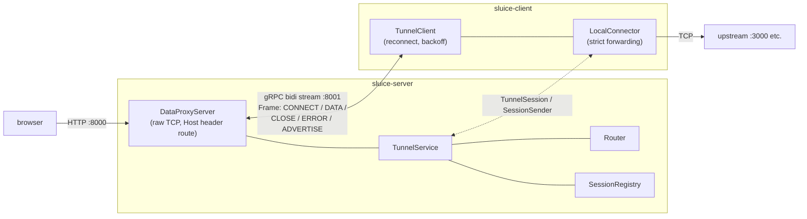
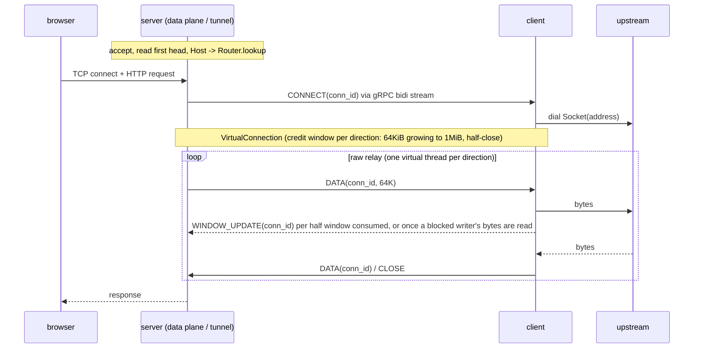
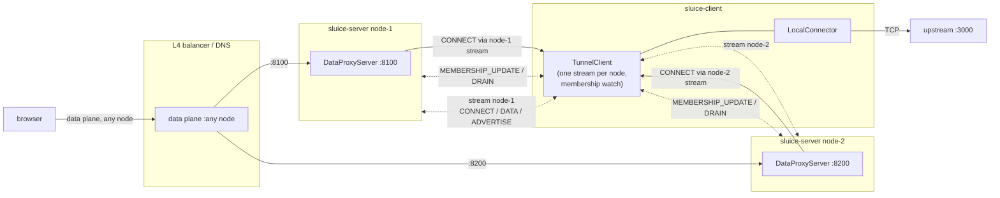

# sluice

HTTP tunnel over a gRPC bidirectional stream, built on Spring Boot 4.1 and Spring gRPC.

A single gRPC bidi stream multiplexes virtual TCP connections (`conn_id`). The data plane is a raw TCP proxy: the request head is inspected for routing (Host / :authority), so WebSocket upgrades and HTTP keep-alive pass through transparently. Each virtual connection has its own flow control window, so a slow connection does not hold back the others on the stream.

## Architecture





- one bidi stream per client; each proxied TCP connection becomes a `conn_id` on that stream
- server: accept, route (by `Host` / `:authority`, TLS SNI or listen port), `CONNECT`, then
  raw relay, one virtual thread per direction
- client: on `CONNECT`, dial the configured upstream (strict forwarding) and relay;
  `https://` upstreams are dialed with TLS, verified against the JDK trust store (any
  certificate with `sluice.insecure=true`)
- flow control: each virtual connection has its own credit window per direction (64KiB,
  growing to 1MiB within the node's `tunnel-budget`), so a stalled reader holds back only
  its own connection. One connection moves at most a window per tunnel round trip: about
  50MiB/s at a 20ms round trip at 1MiB, about 3MiB/s at 64KiB
- compatibility: both ends must announce a per-connection window (sluice-server /
  sluice-client 046cd21, sluice-wicket-wasi f76388d or later); an older peer is refused

Details: [.kb/tunnel-flow-control.md](.kb/tunnel-flow-control.md).

## Constraints and notes

- The data plane relays raw bytes. With `rewrite-host=true` the authority (`Host` / `:authority`) is rewritten on every request of the connection, both HTTP/1.1 and h2; upgraded connections (WebSocket, h2c upgrade, CONNECT) are rewritten up to the protocol switch.
- h2 (plaintext and TLS-terminated) is demultiplexed, not relayed verbatim: every stream is routed by its own `:authority`, access-checked and logged, and flow control, settings and errors are per hop. An upstream's failure ends only the streams it covers, never the client's connection. Details: [.kb/h2-demux.md](.kb/h2-demux.md).
- Malformed HTTP/1.1 requests (request smuggling vectors such as a duplicated `Host`, an invalid `Content-Length` or chunked framing) are not relayed: nothing from the malformed bytes on reaches the upstream, the client gets `400` (unless the upstream already began answering) and the connection is closed. Details: [.kb/http1-relay.md](.kb/http1-relay.md).
- Upstream without HTTP/2 support: set `force-http1=true` on the upstream. The data plane's TLS termination then prefers http/1.1 in ALPN for the route, and an h2 stream that still reaches it (a browser coalescing the host onto another host's h2 connection, an h2-only or h2c client) is answered `421 Misdirected Request`, which Chrome and Firefox retry on a new connection. Without it, an `https://` upstream that does not negotiate h2 fails the route's h2 streams with `502` and the client logs a warning naming `force-http1`.

## Modules

- `sluice-proto` - `.proto` contract, generated stubs, and the shared tunnel primitives (`VirtualConnection`, `SessionSender`, `SocketRelay`)
- `sluice-server` - exit node: gRPC control plane (`spring.grpc.server.port`, default 8001) + raw TCP data plane (`sluice.data-port`, default 8000) + actuator and management console (`server.port`, default 8081)
- `sluice-client` - tunnel client: connects to the server, advertises upstreams, dials local upstreams on CONNECT, reconnects with jittered exponential backoff (ceiling 1s..30s, each wait drawn from its upper half), actuator on `server.port` (default 9001)
- `sluice-wicket-wasi` - experimental Rust client: like `sluice-client` on the tunnel side, but terminates HTTP and hands each request to a `wasi:http` component (wasmtime) instead of dialing a TCP upstream; see its README
- `sluice-it` - full stack integration tests running the real server and client applications in one JVM (proxying, reconnect after server restart, wrong-token rejection)
- `sluice-example-upstream` - minimal sample upstream for manual checks (`It works` over http/1.1 and h2c)

## Build

```
./mvnw verify
```

Requires JDK 25+. The `sluice-it` classes run in 6 JVMs at once (`-Dsluice.it.forks=N` to
change), a class at a time in each.

Build the executable jars (the `-exec.jar` files used in "Run"):

```
./mvnw -DskipTests package
```

### Native image (client / server)

GraalVM native images (require a GraalVM JDK; AOT processing and `native-image` run in
the `package` phase):

```
./mvnw -pl sluice-client -am -Pnative -DskipTests package
./mvnw -pl sluice-server -am -Pnative -DskipTests package
sluice-client/target/sluice-client --sluice.server-url=grpc://127.0.0.1:8001 ...
sluice-server/target/sluice-server --sluice.token=SECRET ...
```

### Docker images

Images are built with Cloud Native Buildpacks (Spring Boot plugin, no Dockerfile). Build deps
first, then the app module only -- running `build-image` on the reactor also hits the library
modules. Append `-Pnative` for GraalVM native images:

```
./mvnw -pl sluice-server -am package spring-boot:build-image -DskipTests
./mvnw -pl sluice-client -am package spring-boot:build-image -DskipTests

# native image: package with -Pnative first (as in "Native image"), then
./mvnw -pl sluice-server -Pnative -DskipTests spring-boot:build-image
./mvnw -pl sluice-client -Pnative -DskipTests spring-boot:build-image
```

This produces `sluice-server:latest` and `sluice-client:latest`. Run:

```
docker run -p 8000:8000 -p 8001:8001 sluice-server --sluice.token=SECRET
docker run sluice-client --sluice.server-url=grpc://host.docker.internal:8001 \
  '--sluice.client.upstream[0]'.host=demo.local '--sluice.client.upstream[0]'.target=http://host.docker.internal:31080 --sluice.token=SECRET
```

## Run

```
# terminal 1: upstream (sample server speaking http/1.1 and h2c on one port)
java -jar sluice-example-upstream/target/sluice-example-upstream-0.0.1-SNAPSHOT-exec.jar 31080

# terminal 2: server
java -jar sluice-server/target/sluice-server-0.0.1-SNAPSHOT-exec.jar \
  --sluice.token=SECRET

# terminal 3: client
java -jar sluice-client/target/sluice-client-0.0.1-SNAPSHOT-exec.jar \
  --sluice.server-url=grpc://127.0.0.1:8001 \
  '--sluice.client.upstream[0]'.host=demo.local \
  '--sluice.client.upstream[0]'.target=http://127.0.0.1:31080 \
  --sluice.token=SECRET

# terminal 4: request through the tunnel (routed by the Host header / :authority)
curl -H 'Host: demo.local' http://127.0.0.1:8000/
curl --http2-prior-knowledge -H 'Host: demo.local' http://127.0.0.1:8000/
```

`sluice.server-url` schemes: `grpc://` (plaintext) / `grpcs://` (TLS; `--sluice.insecure=true` skips
verification). For mutual TLS see "Mutual TLS (server <-> client)".

### Published Docker images

Multi-arch (amd64 / aarch64) JVM and native images are published to ghcr.io on every push to
`main`: `ghcr.io/making/sluice/sluice-server:{jvm,native}` and
`ghcr.io/making/sluice/sluice-client:{jvm,native}` (immutable `jvm_<sha>` / `native_<sha>` tags too).

```
docker run --rm --pull always --name sluice-server -p 8000:8000 -p 8001:8001 -p 8081:8081 \
  ghcr.io/making/sluice/sluice-server:native --sluice.token=SECRET

docker run --rm --pull always --name sluice-client \
  -e SLUICE_SERVER_URL=grpc://host.docker.internal:8001 \
  -e SLUICE_TOKEN=SECRET \
  -e SLUICE_CLIENT_UPSTREAM_0_HOST=demo.local \
  -e SLUICE_CLIENT_UPSTREAM_0_TARGET=http://host.docker.internal:31080 \
  ghcr.io/making/sluice/sluice-client:native

curl -H 'Host: demo.local' http://127.0.0.1:8000/
```

Relaxed binding maps `SLUICE_SERVER_URL` / `SLUICE_TOKEN` /
`SLUICE_CLIENT_UPSTREAM_0_HOST` / `SLUICE_CLIENT_UPSTREAM_0_TARGET` to the properties above
(`host.docker.internal` reaches ports published on the host).

## Data plane features

### TLS termination

The data port terminates TLS when `sluice.data-tls-bundle` names an SSL bundle: h2 and
http/1.1 are negotiated via ALPN, and plaintext is still served on the same port. With the
upstream / server / client of "Run":

```
# self-signed cert registered as an SSL bundle, then restart the server with
#   --sluice.data-tls-bundle=data-plane
#   --spring.ssl.bundle.pem.data-plane.keystore.certificate=cert.pem
#   --spring.ssl.bundle.pem.data-plane.keystore.private-key=cert-key.pem
openssl req -x509 -newkey rsa:2048 -keyout cert-key.pem -out cert.pem -days 1 -nodes -subj /CN=localhost

# h2 over TLS (ALPN) / http/1.1 fallback / plaintext on the same port
curl --http2 -k -H 'Host: demo.local' https://127.0.0.1:8000/ -v -o /dev/null 2>&1 | grep 'using HTTP/2' -A2
curl --http1.1 -k -H 'Host: demo.local' https://127.0.0.1:8000/
```

TLS passthrough routed by SNI: see "SNI routing".

### TCP port routing

Upstreams with `listen-port` are routed by the listen port instead of the connection
head: the server opens one listener per advertised port and relays every accepted
connection verbatim -- no head parsing, no rewriting -- so any TCP protocol (ssh,
postgres, redis, ...) tunnels through, not just HTTP. Such an upstream is reached only
through its port: its `host` takes no part in Host / SNI routing on the data port, so it
neither captures http traffic for that host nor becomes the catch-all when empty.

```
# terminal 1: any TCP server, e.g. redis
redis-server --port 6379

# terminal 2: server (listeners bind on the data host)
java -jar sluice-server/target/sluice-server-0.0.1-SNAPSHOT-exec.jar \
  --sluice.token=SECRET

# terminal 3: client; the upstream target is a tcp:// URL
java -jar sluice-client/target/sluice-client-0.0.1-SNAPSHOT-exec.jar \
  --sluice.server-url=grpc://127.0.0.1:8001 \
  '--sluice.client.upstream[0]'.host=redis.local \
  '--sluice.client.upstream[0]'.target=tcp://127.0.0.1:6379 \
  '--sluice.client.upstream[0]'.listen-port=16379 \
  --sluice.token=SECRET

# terminal 4: connect to the advertised port
redis-cli -p 16379 ping
# -> PONG
```

The listener is bound when the client advertises and released on disconnect; the
server acknowledges the advertisement and reports back the listen ports it could
not bind (outside `sluice.tcp-port-range`, held by another connected client, or
already taken) -- the client keeps the stream (its other routes stay up) and
re-advertises on it with the same jittered backoff (ceiling 1s..30s) until the ports bind. The listen ports
must be exposed on the host (`docker -p`, firewall) -- the deployment delta against
the single data port.

### SNI routing

Where TCP port routing keys on the listen port, these two variants route a TLS
connection by the server name of its ClientHello:

- **TLS passthrough** (`sluice.client.upstream[n].tls-passthrough=true`): the data
  plane relays the TLS bytes untouched and routes by the ClientHello SNI; the upstream
  terminates TLS and presents its own certificate. The upstream target is a plain
  `tcp://` URL — the tunneled bytes are the already-encrypted TLS records.
- **TLS termination** (the default): the data plane terminates TLS (an SSL bundle via
  `sluice.data-tls-bundle` is required) and falls back to the SNI host name when the
  decrypted stream carries no HTTP `Host` header (any protocol works, e.g. RESP); the
  upstream target is then an everyday plaintext `tcp://` / `http://` URL.

Passthrough example, all four terminals:

```
# terminal 1: a TLS upstream (any TLS server works; here openssl's demo server
#   serving the current directory over HTTPS)
echo 'it-works-sni' > index.html
openssl req -x509 -newkey rsa:2048 -keyout cert-key.pem -out cert.pem -days 1 -nodes -subj /CN=demo.local
openssl s_server -accept 34443 -cert cert.pem -key cert-key.pem -WWW

# terminal 2: server (no TLS configuration on the data port)
java -jar sluice-server/target/sluice-server-0.0.1-SNAPSHOT-exec.jar \
  --sluice.token=SECRET

# terminal 3: client; tls-passthrough relays the TLS records as-is
java -jar sluice-client/target/sluice-client-0.0.1-SNAPSHOT-exec.jar \
  --sluice.server-url=grpc://127.0.0.1:8001 \
  '--sluice.client.upstream[0]'.host=demo.local \
  '--sluice.client.upstream[0]'.target=tcp://127.0.0.1:34443 \
  '--sluice.client.upstream[0]'.tls-passthrough=true \
  --sluice.token=SECRET

# terminal 4: request by SNI; --resolve sends ClientHello server_name=demo.local
#   to the data port
curl -k --resolve demo.local:8000:127.0.0.1 https://demo.local:8000/index.html
# -> it-works-sni
```

### Route authentication

A route can require credentials on the data plane, configured on the server under its route
key -- the key the console shows: the domain, the host pattern as written, `*` for the
catch-all:

```properties
# HTTP Basic: user name = password
sluice.route.auth.[admin.example.com].basic.alice={bcrypt}$2a$10$...
# Authorization: Bearer <token>
sluice.route.auth.[api.example.com].bearer[0]={sha256}9f86d081884c7d65...
# an API token header
sluice.route.auth.[api.example.com].api-token[0]={sha256}...
```

The credentials can live in a file of their own, imported at startup
(`spring.config.additional-location` or `spring.config.import`):

```properties
# /etc/sluice/route-auth.properties
sluice.route.auth.[admin.example.com].basic.alice={bcrypt}$2a$10$...
```

```console
docker run --rm --pull always --name sluice-server -p 8000:8000 -p 8001:8001 -p 8081:8081 \
  -v /etc/sluice:/etc/sluice:ro \
  -e sluice.token=SECRET \
  -e spring.config.additional-location=optional:file:/etc/sluice/route-auth.properties \
  ghcr.io/making/sluice/sluice-server:native
```

| Property (under `sluice.route.auth.[<route key>]`) | Default | Description |
|---|---|---|
| `basic.<user>` | - | HTTP Basic users and their passwords |
| `bearer[n]` | - | tokens accepted as `Authorization: Bearer <token>` |
| `api-token[n]` | - | tokens accepted in the API token header |
| `api-token-header` | `X-API-Token` | the header carrying an API token |
| `realm` | the route key | the realm of the challenges |
| `forward-credentials` | `false` | relay the credential headers to the upstream; by default they are removed |
| `allow-preflight` | `false` | let a CORS preflight (`OPTIONS` with `Access-Control-Request-Method`) pass without credentials: browsers send none on it |

- The data plane's error answers (`401`, `403`, `502`, `503`) are HTML pages. A request whose
  `Content-Type` is JSON, or whose `Accept` lists a JSON type and no `text/html`, gets a
  `application/problem+json` document (RFC 9457) instead; `WWW-Authenticate` and `Retry-After`
  stay headers.

- A request passes with any one credential of its route. Otherwise it is answered `401` with a
  `WWW-Authenticate` challenge per scheme of the route (`Basic realm="<realm>", charset="UTF-8"`,
  `Bearer realm="<realm>"`, `<api-token-header> realm="<realm>"`) and never reaches the upstream.
  A request carrying a credential header of the route twice is refused whatever the values.
- Every HTTP/1.1 request head and every h2 stream is checked, plaintext or TLS-terminated, after
  `allowed-cidrs` (`403` before `401`). On HTTP/1.1 a refused request is answered once the
  responses to the requests before it are relayed, then the connection closes; on h2 the
  connection goes on. A WebSocket is checked on its upgrade request only: browsers cannot add
  headers to it, so bearer / API tokens there serve non-browser clients.
- Unless `forward-credentials=true`, `Authorization` (Basic, Bearer) and the API token header
  are removed from every request of the route before it is relayed.
- Only a request the data plane reads can be checked: a TLS passthrough or non-HTTP connection
  to such a route is closed unrelayed, and the server warns at the advertise of a TLS passthrough
  upstream under such a key; a `tcp:<port>` key fails the start.
- Each secret carries the `{id}` of its encoder: `bcrypt`, `pbkdf2`,
  `pbkdf2@SpringSecurity_v5_8`, `noop` (the value itself), `sha256` (the hex SHA-256 of the
  UTF-8 value, unsalted: for high-entropy tokens, never for passwords people choose; e.g.
  `printf %s "$TOKEN" | sha256sum`). scrypt and argon2 are not supported (they need Bouncy
  Castle). A secret without a prefix, with an unknown id or malformed for its encoder fails the
  start, as does a route with no credential.
- A credential that matched is remembered per route by its SHA-256 for 10 minutes (up to 10000
  of them), so a client's later requests skip the encoder; one that did not match is never
  remembered. At most as many checks against `bcrypt` / `pbkdf2` as CPUs (at least 2) run at
  once; a request whose check would take one more is answered `503` with `Retry-After: 1`, and
  requests presenting the credential of a check under way wait for that check. bcrypt and
  pbkdf2 cost milliseconds per check by design: prefer `sha256` for tokens.
- On h2 such a check holds its own stream only: the connection's other streams go on
  meanwhile. A stream whose check has not ended after `sluice.limits.h2-stream-wait-timeout`
  is refused with `REFUSED_STREAM`. Details: [.kb/h2-demux.md](.kb/h2-demux.md).
- Without `sluice.data-tls-bundle` the server warns at startup that the credentials cross the
  data plane in cleartext unless a front end terminates TLS.
- Refusals are logged as `type=req ... status=401 reason=auth-missing` (no credential),
  `reason=auth-invalid`, `reason=auth-unreadable` (passthrough / non-HTTP), and `status=503
  reason=auth-busy`. The console tags such a route `Auth: <schemes>`.

## Cluster

### Scale-out

Run N server nodes: every client keeps one tunnel stream to every node, so each node holds
the full route table locally -- no shared store, no inter-node hop.

Deployment requirements (independent of the front end):

- each node's control plane is reachable from clients at its own address (per-node URL)
- data plane connections may land on any node (plain L4 balancing is enough)

```
# terminal 1/2: two nodes sharing one membership list and token
java -jar sluice-server/target/sluice-server-0.0.1-SNAPSHOT-exec.jar \
  --sluice.token=SECRET --sluice.node.id=node-1 \
  --spring.grpc.server.port=8101 --sluice.data-port=8100 --server.port=18180 \
  --sluice.cluster.nodes=node-1=grpc://127.0.0.1:8101,node-2=grpc://127.0.0.1:8201
java -jar sluice-server/target/sluice-server-0.0.1-SNAPSHOT-exec.jar \
  --sluice.token=SECRET --sluice.node.id=node-2 \
  --spring.grpc.server.port=8201 --sluice.data-port=8200 --server.port=18181 \
  --sluice.cluster.nodes=node-1=grpc://127.0.0.1:8101,node-2=grpc://127.0.0.1:8201

# terminal 3: client -- server-url is only the bootstrap; the node list is learned
# via ListNodes and one stream is opened per node
java -jar sluice-client/target/sluice-client-0.0.1-SNAPSHOT-exec.jar \
  --sluice.server-url=grpc://127.0.0.1:8101 --sluice.client.id=client-1 \
  '--sluice.client.upstream[0]'.host=demo.local \
  '--sluice.client.upstream[0]'.target=http://127.0.0.1:31080 \
  --sluice.token=SECRET

# terminal 4: either node serves the route
curl -H 'Host: demo.local' http://127.0.0.1:8100/
curl -H 'Host: demo.local' http://127.0.0.1:8200/
```



Each node routes with its own full copy of the route table (every client advertises to
every node), so the data plane never hops between nodes.

Behavior:

- membership: `sluice.cluster.nodes` lists the members as `nodeId=publicUrl` entries (the
  local node is always included). It is pushed to every client once it advertised and whenever it
  changes (`MEMBERSHIP_UPDATE` frame); the client opens/closes per-node streams accordingly.
  A node with an empty public url is reachable at the address the client bootstrapped with
- routing: a domain (or listen port) claimed by several clients is served by the one with
  the smallest `sluice.client.id` -- deterministically on every node, since every node sees
  every client. A smaller id takes over a bound listen port on advertise; a larger id gets
  the port rejected and retries on the same stream. A port whose owner leaves is bound
  for the next smallest id serving it
- lifecycle: readiness (`/actuator/health/readiness`) is DOWN for `sluice.cluster.warmup`
  after start (clients connect first) and while draining. On shutdown the node sends a
  `DRAIN` frame, waits up to `sluice.cluster.drain-grace` for in-flight virtual connections
  to finish, then closes the streams. Clients keep their other nodes' streams and retry the
  drained node with backoff
- configuration: cluster mode refuses to start without an explicit `sluice.token` /
  `sluice.token-file` (per-node random tokens would break clients connected to every node)
- observability: every server metric carries a `node` common tag; the client health details show
  the per-node stream states

Without `sluice.cluster.nodes` the server runs single-node and nothing above applies
(`ListNodes` returns just the node itself).

### TLS control plane

The control plane can serve TLS (`spring.grpc.server.ssl.bundle`), so a front end routes
per node by SNI without terminating TLS. Verified end to end with a self-signed certificate;
no code difference from the plaintext cluster, only configuration:

```
# self-signed cert for the gRPC control plane
openssl req -x509 -newkey rsa:2048 -keyout grpc-key.pem -out grpc-cert.pem -days 1 -nodes -subj /CN=localhost

# terminal 1/2: same cluster as above, plus the TLS bundle on every node
java -jar sluice-server/target/sluice-server-0.0.1-SNAPSHOT-exec.jar \
  --sluice.token=SECRET --sluice.node.id=node-1 \
  --spring.grpc.server.port=8101 --sluice.data-port=8100 --server.port=18180 \
  --sluice.cluster.nodes=node-1=grpcs://127.0.0.1:8101,node-2=grpcs://127.0.0.1:8201 \
  --spring.grpc.server.ssl.bundle=grpc-control \
  --spring.ssl.bundle.pem.grpc-control.keystore.certificate=file:grpc-cert.pem \
  --spring.ssl.bundle.pem.grpc-control.keystore.private-key=file:grpc-key.pem
java -jar sluice-server/target/sluice-server-0.0.1-SNAPSHOT-exec.jar \
  --sluice.token=SECRET --sluice.node.id=node-2 \
  --spring.grpc.server.port=8201 --sluice.data-port=8200 --server.port=18181 \
  --sluice.cluster.nodes=node-1=grpcs://127.0.0.1:8101,node-2=grpcs://127.0.0.1:8201 \
  --spring.grpc.server.ssl.bundle=grpc-control \
  --spring.ssl.bundle.pem.grpc-control.keystore.certificate=file:grpc-cert.pem \
  --spring.ssl.bundle.pem.grpc-control.keystore.private-key=file:grpc-key.pem

# terminal 3: client -- grpcs:// bootstrap, insecure trusts the self-signed cert;
# membership URLs (grpcs://) are dialed with the same setting
java -jar sluice-client/target/sluice-client-0.0.1-SNAPSHOT-exec.jar \
  --sluice.server-url=grpcs://127.0.0.1:8101 --sluice.insecure=true --sluice.client.id=client-1 \
  '--sluice.client.upstream[0]'.host=demo.local \
  '--sluice.client.upstream[0]'.target=http://127.0.0.1:31080 \
  --sluice.token=SECRET

# terminal 4: both nodes serve over their TLS control planes
curl -H 'Host: demo.local' http://127.0.0.1:8100/
curl -H 'Host: demo.local' http://127.0.0.1:8200/

# the control plane negotiates h2 via ALPN
echo | openssl s_client -connect 127.0.0.1:8101 -alpn h2 2>/dev/null | grep 'ALPN protocol'
```

E2E coverage: `ClusterGrpcTlsE2ETests` (sluice-it) -- both nodes serve, failover after a
node stops, and h2 negotiation on the TLS endpoint.

### Mutual TLS (server <-> client)

The server requires a client certificate (`client-auth=REQUIRE`) and the client presents one
from an SSL bundle (`sluice.tls-bundle`); no `sluice.insecure` needed. Client certificates can
also be issued from the console; see "Client certificate issuance". Example with a local CA:

```sh
# a private CA and two leaf certificates signed by it
openssl req -x509 -newkey rsa:2048 -nodes -keyout ca-key.pem -out ca.pem \
  -days 3650 -subj /CN=sluice-ca -addext basicConstraints=critical,CA:TRUE
openssl req -newkey rsa:2048 -nodes -keyout server-key.pem -out server.csr -subj /CN=localhost
openssl x509 -req -in server.csr -CA ca.pem -CAkey ca-key.pem -days 3650 \
  -extfile <(printf 'subjectAltName=DNS:localhost,IP:127.0.0.1\n') -out server-cert.pem
openssl req -newkey rsa:2048 -nodes -keyout client-key.pem -out client.csr -subj /CN=sluice-client
openssl x509 -req -in client.csr -CA ca.pem -CAkey ca-key.pem -days 3650 -out client-cert.pem
openssl verify -CAfile ca.pem server-cert.pem client-cert.pem
```

```sh
# server: terminate TLS on the control plane and require client certificates
java -jar sluice-server/target/sluice-server-0.0.1-SNAPSHOT-exec.jar \
  --sluice.token=SECRET --spring.grpc.server.port=8001 --sluice.data-port=8000 \
  --spring.grpc.server.ssl.bundle=grpc-control \
  --spring.grpc.server.ssl.client-auth=REQUIRE \
  --spring.ssl.bundle.pem.grpc-control.keystore.certificate=file:server-cert.pem \
  --spring.ssl.bundle.pem.grpc-control.keystore.private-key=file:server-key.pem \
  --spring.ssl.bundle.pem.grpc-control.truststore.certificate=file:ca.pem

# client: keystore = the client certificate, truststore = the CA that signed the server cert
java -jar sluice-client/target/sluice-client-0.0.1-SNAPSHOT-exec.jar \
  --sluice.server-url=grpcs://127.0.0.1:8001 --sluice.tls-bundle=grpc-client --sluice.client.id=client-1 \
  '--sluice.client.upstream[0]'.host=demo.local \
  '--sluice.client.upstream[0]'.target=http://127.0.0.1:31080 \
  --spring.ssl.bundle.pem.grpc-client.keystore.certificate=file:client-cert.pem \
  --spring.ssl.bundle.pem.grpc-client.keystore.private-key=file:client-key.pem \
  --spring.ssl.bundle.pem.grpc-client.truststore.certificate=file:ca.pem \
  --sluice.token=SECRET
```

The client bundle is applied to every node connection (the bootstrap and the membership
`grpcs://` URLs alike). `client-auth` also accepts `OPTIONAL` / `WANT` / `NONE`.

E2E coverage: `ClusterGrpcMutualTlsE2ETests` (sluice-it) -- mTLS to both nodes with failover,
rejection of a certificate-less client, a certificate issued through the console
(`sluice.ca-bundle`), and TLS termination / passthrough on the data plane over the mTLS
tunnel.

## Operations

### Connection limits

Everything a peer can hold on the server or the client is bounded. Defaults are derived
from the max heap or fixed; the effective connection limits are logged at startup
(`data plane connection limit` / `upstream connection limit`) and exported as gauges.
Properties are listed under "Configuration (server)" / "Configuration (client)".

- Connections: the data port and every tcp route port share `sluice.limits.max-connections`
  and `sluice.limits.connection-memory`, taken at accept; a connection beyond either is
  closed unread. Each connection reserves 293KiB, an h2 connection 711KiB more, each
  further upstream connection of an h2 connection 552KiB (and a slot). Unset, the limit is
  `max(1, (max heap / 2 - h2 queue budget - tunnel budget - overflow x 256KiB) / 293KiB)`:
  529 connections for a 409MiB heap (or 154 h2 connections with one upstream connection
  each), 5361 for 4GiB. The client: `max(1, (max heap / 2 - tunnel budget) / 293KiB)`;
  a `CONNECT` beyond it gets an ERROR and the server closes the public connection.
- Overflow: up to `sluice.limits.overflow-connections` (8) data port connections past the
  limit are answered `503` with `Retry-After` instead of closed, within
  `overflow-timeout` (5s). tcp route ports and TLS passthrough have no overflow.
- Per source address: `max-connections-per-address` and the per-address tunnel limits are
  off by default, since behind an SNAT front end without the PROXY protocol every
  connection carries the front end's address.
- Head: `head-timeout` (10s) is one deadline for the PROXY header, TLS handshake and
  request head together, so a peer dripping its head is cut too.
- Idle: `idle-timeout` (60s) closes an HTTP connection idle between requests. Behind a front
  end that reuses its connections, set it above the front end's idle timeout.
- Stall: `stall-timeout` (60s) closes an HTTP connection whose client does not read its
  response or send the request body it owes, at less than `stall-min-bytes` (16KB) per
  timeout. Waiting for the upstream never counts. A client streaming small pieces slowly (a
  gRPC client stream) is cut too: set `stall-min-bytes=1B` or raise the timeout.
- Verbatim: TLS passthrough, tcp routes, hostless and upgraded (WebSocket) connections are
  bounded only by the verbatim idle timeout, off by default: set
  `sluice.client.upstream[n].verbatim-idle-timeout` per route, or
  `sluice.limits.verbatim-idle-timeout` for every route without one. Until then a quiet
  peer holds its slot.
- Vanished peers: TCP keepalive on every data plane and upstream socket
  (`tcp-keep-alive`, 60s idle, then 3 probes 10s apart) ends connections whose peer is
  gone without a FIN or reset.
- Half-closed clients: an HTTP client that ended its side while a response is owed is
  probed (`100 Continue` on HTTP/1.1, PING on h2) after `half-close-probe-interval` (1s),
  so a gone client releases its upstream connection.
- Tunnel: a peer that stops reading the tunnel stream is cut after
  `tunnel-stall-timeout` (60s, both sides); streams waiting for their first `Advertise`
  are bounded by `advertise-timeout` (10s) and `max-pending-tunnel-streams` (256),
  registered clients by `max-tunnel-sessions` (1024). A stream past a bound fails with
  `RESOURCE_EXHAUSTED` and the client retries with its backoff.
- Rejected connections are logged as rate-limited `type=conn event=reject` access log
  lines and counted in `sluice_data_connections_rejected_total` by `reason`.

Details (overflow handling, reservations, probes, slot release, log throttles):
[.kb/connection-limits.md](.kb/connection-limits.md). Tunnel and h2 buffering:
[.kb/tunnel-flow-control.md](.kb/tunnel-flow-control.md), [.kb/h2-demux.md](.kb/h2-demux.md).

### Client shutdown (drain)

On SIGTERM / SIGINT the client drains before it closes:

- It withdraws its routes on every server node. From then on the server sends new
  connections, the next request of an HTTP/1.1 keep-alive connection and new tcp route
  connections to the other clients serving the route; a listen port it owned is bound
  for the next smallest id serving it. The console shows the client as `Draining`.
- The connections open on it keep relaying until they end. Once none is left on a node,
  the node acknowledges the withdrawal and the client ends that stream.
- After `sluice.client.drain-grace` (20s) the connections still open are closed and logged
  (`drain grace PT20S expired; closing N open connection(s)`). `0` closes at once.
- Connections that hold the drain: in-flight requests, WebSocket / TLS passthrough / tcp
  route connections, and idle keep-alive or h2 connections whose last request went
  through this client (until their next request, the server's `idle-timeout`, or the
  grace).
- A route served by this client alone answers `503` from the withdrawal on, rather than
  accepting requests the grace may cut.
- A second SIGTERM / SIGINT during the drain closes at once.
- A server predating the drain keeps routing to the client; the client then closes that
  node's stream at once, as before.

`docker compose stop` (and `up -d` replacing a container) sends SIGKILL 10s after SIGTERM:
set `stop_grace_period` above `drain-grace`, e.g. `30s` for the default. On Kubernetes,
`terminationGracePeriodSeconds` (30s by default) bounds it the same way.

```yaml
services:
  sluice-client:
    image: ghcr.io/making/sluice/sluice-client:native
    stop_grace_period: 30s
```

### gRPC keepalive

The tunnel is one long-lived gRPC stream; NAT / load balancers silently drop idle
connections, so both sides keep it warm with HTTP/2 pings and the server-side values are
set explicitly in `sluice-server/src/main/resources/application.properties`:

| Setting | Value | Reason |
|---|---|---|
| server `spring.grpc.server.keepalive.time` / `spring.grpc.server.keepalive.timeout` | `30s` / `10s` | the server pings clients and reaps dead ones (session and routes released ~40s after silent death) |
| server `spring.grpc.server.keepalive.permit.time` / `spring.grpc.server.keepalive.permit.without-calls` | `10s` / `true` | client pings every 30s; grpc's default permit (5m) risks `GOAWAY TOO_MANY_PINGS` |
| client `sluice.keep-alive-time` / `sluice.keep-alive-timeout` | `30s` / `10s` | pings keep NAT mappings alive; an unanswered ping tears the channel down and the reconnect backoff (ceiling 1s..30s, jittered) takes over |

Application-level `KEEPALIVE` frames are not sent: the gRPC (HTTP/2) ping already
provides liveness. The frame type stays in the proto for future use and is handled as a
no-op on both sides. `GrpcKeepAliveTest` (sluice-it) guards the behavior with a 1s-ping
channel.

### Health / metrics

- server `GET /actuator/health` - liveness, UP while the process lives; details `clients`
  (connected tunnel clients) and `draining`. `/actuator/health/readiness` is DOWN during the
  cluster warmup window and while draining (see "Cluster")
- client `GET /actuator/health` (port 9001) - UP while at least one per-node tunnel stream is
  established; the `tunnel` detail shows the connection state and `nodes` each node's stream state
- `GET /actuator/prometheus` - JVM metrics plus the `sluice_*` meters (the server's tagged with `node`):
  - tunnel: `sluice_tunnel_bytes_total` (by route), `sluice_tunnel_sessions`, window / credit / budget / stall meters (`sluice_tunnel_window_updates_total`, `sluice_tunnel_budget_used_bytes`, `sluice_tunnel_stall_seconds`, ...), refused streams (`sluice_tunnel_streams_refused_total`)
  - client: `sluice_connections_active`, `sluice_reconnect_total`, `sluice_advertise_rejected_total`, `sluice_connections_limit` / `_admitted` / `_rejected_total`
  - data plane (server): `sluice_data_connections_limit` / `_admitted` / `_rejected_total` (`reason`), memory, overflow and timeout counters
  - h2 demux (server): `sluice_h2demux_*` (bytes held, budget, withheld windows, refused / reset streams by `reason`)

  Every meter with its tags: [.kb/metrics.md](.kb/metrics.md).

#### Grafana dashboard

`dashboards/sluice.json` is a Grafana dashboard over these metrics, one JSON for the
server and the clients: rows for the tunnel, the data plane and the h2 demux (server), the
client's upstream connections, and JVM / process basics; a panel of the other app shows no
data. Variables, each narrowed by the ones before it: `datasource` (Prometheus), `app`
(the apps exposing `sluice_tunnel_window_updates_total`) and `cluster`, then `instance`,
`namespace`, `pod` and `route`, multi-select. Every query selects
`{app=~"$app", cluster=~"$cluster", instance=~"$instance", namespace=~"$namespace", pod=~"$pod"}`,
so the series must carry `app`, `cluster`, `namespace` and `pod` (`instance` is the scrape
target's). The apps do not add them (the server tags its meters with `node` only): attach
them in the scrape configuration, e.g. statically:

```yaml
scrape_configs:
- job_name: sluice
  metrics_path: /actuator/prometheus
  static_configs:
  - targets: [ "sluice-server:8081" ]
    labels: { app: sluice-server, cluster: prod, namespace: sluice, pod: sluice-server-0 }
  - targets: [ "sluice-client:9001" ]
    labels: { app: sluice-client, cluster: prod, namespace: demo, pod: sluice-client-0 }
```

Import it from the Grafana UI (Dashboards > New > Import), or provision it with a file
provider pointing at a directory holding the JSON. The native server image checked
exported no GC pause timer, so its GC panel shows only the overhead.
`GrafanaDashboardE2ETest` fails the build when a metric the dashboard queries is in
neither the server's nor the client's scrape, or a query does not select the label
variables.

### Console

`http://<server>:8081/console` (the actuator port) shows the live state of one node: the
public listeners, connected clients with their build, upstreams and traffic, the http / tcp route
tables with the client each route resolves to, the cluster membership and the effective
settings. A "Find a route" box tells which client serves a given Host header without
touching load balancing state. The page refreshes every 2s.

Each client row shows the build the client (Java client or wicket) announced in its
`Advertise`: implementation, version and short commit, with the full commit and build time on
hover. A client that predates build reporting shows `Unknown (older build)`; the gauge
`sluice_tunnel_sessions_build_unknown` counts them per node.
The server logs each client's build at its first `Advertise`; the Java client logs the server's
build when its stream comes up.

#### Client certificate issuance

With a CA configured, the console issues client certificates for the mTLS control plane:
the `Client certificate` panel links to `/console/certificates`, where a common name and
validity produce a zip download with three PEM files -- `<name>.crt.pem`,
`<name>.key.pem` (PKCS#8) and `ca.crt.pem` -- mapping one to one onto the
`sluice.tls-bundle` keystore / private-key / truststore properties. No server restart is
needed -- the control plane truststore already pins the CA:

```properties
# sluice.ca-bundle=console-ca
# spring.ssl.bundle.pem.console-ca.keystore.private-key=file:ca-key.pem
# spring.ssl.bundle.pem.console-ca.keystore.certificate=ca.pem
```

The panel and the page are read-only until `sluice.ca-bundle` is set. Keys are created on
the server at issuance time (no CSR handling); revocation and renewal are out of scope.

#### Console authentication

The console requires a signed-in user; the actuator endpoints and the console static
assets stay open. The mechanism is `sluice.console.auth.type`:

- `simple` (default): form login with `spring.security.user.name` /
  `spring.security.user.password` (prefixed with the `{id}` of its encoder, e.g. `{noop}` /
  `{bcrypt}`; see "Route authentication" for the ids), e.g.
  `docker run ... -e SPRING_SECURITY_USER_NAME=admin -e SPRING_SECURITY_USER_PASSWORD='{noop}secret'`
- `oidc`: sign in through an OpenID Provider, configured with the standard
  `spring.security.oauth2.client.*` properties

```properties
# Enable OIDC authentication
sluice.console.auth.type=oidc

# Configure Google as the identity provider
spring.security.oauth2.client.provider.google.issuer-uri=https://accounts.google.com
spring.security.oauth2.client.provider.google.user-name-attribute=email
spring.security.oauth2.client.registration.google.client-id=your-google-client-id
spring.security.oauth2.client.registration.google.client-secret=your-google-client-secret
spring.security.oauth2.client.registration.google.client-name=Google
spring.security.oauth2.client.registration.google.scope=openid,email

# Configure Microsoft Entra ID (formerly Azure AD) as another provider
spring.security.oauth2.client.provider.microsoft-entra-id.issuer-uri=https://sts.windows.net/{tenant-id}/
spring.security.oauth2.client.provider.microsoft-entra-id.user-name-attribute=email
spring.security.oauth2.client.registration.microsoft-entra-id.client-id=your-client-id
spring.security.oauth2.client.registration.microsoft-entra-id.client-secret=your-client-secret
spring.security.oauth2.client.registration.microsoft-entra-id.client-name=Microsoft Entra ID
spring.security.oauth2.client.registration.microsoft-entra-id.scope=openid,email
```

Multiple providers can be configured simultaneously; the login page shows one button per
provider. Register the redirect URI `http://<server>:8081/login/oauth2/code/<registration-id>`
at the provider (e.g. `.../login/oauth2/code/google` for the configuration above).

Signing out of the console also ends the session at the provider (RP-initiated logout) when
its discovery document advertises an `end_session_endpoint`; register
`http://<server>:8081/login?logout` as the post-logout redirect URI. Providers without one
(e.g. Google) end only the console session.

## Configuration (server)

### Ports and token

| Property | Default | Description |
|---|---|---|
| `sluice.data-host` | `0.0.0.0` | bind address of the data plane |
| `sluice.data-port` | `8000` | data plane port |
| `spring.grpc.server.port` | `8001` | gRPC control plane port |
| `server.port` | `8081` | actuator (health / info / prometheus) and the management console (`/console`) |
| `sluice.token` | (unset = auto-generated; the generated token is written to a temporary file whose path is logged) | bearer token for tunnel clients (`Authorization: Bearer <token>`, constant-time compare) |
| `sluice.token-file` | - | read the token from a file |

### TLS and PROXY protocol

| Property | Default | Description |
|---|---|---|
| `sluice.data-tls-bundle` | - | SSL bundle name for data plane TLS termination (h2 / http/1.1 via ALPN, `force-http1` flips the preference); unset = plaintext only (TLS connections are served by upstreams with `tls-passthrough=true`) |
| `sluice.ca-bundle` | - | SSL bundle whose keystore holds the CA private key + certificate; enables client certificate issuance in the console (the signed certificates authenticate against the gRPC `client-auth=REQUIRE` truststore, no restart) |
| `sluice.data-proxy-protocol` | `false` | parse the PROXY protocol (v1 / v2) header an SNAT front end prepends on the data port and tcp route ports; its source address is used for access control and the access log. Headerless connections are served, but a tcp route whose server speaks first needs the header. The header is taken from any peer: expose the ports only to the front end. Details: [.kb/proxy-protocol.md](.kb/proxy-protocol.md) |
| `sluice.control-proxy-protocol` | `false` | the same on the gRPC control plane, ahead of its TLS: the source becomes the tunnel session's remote address and the address of the per-address tunnel limits |

### Routing and access control

| Property | Default | Description |
|---|---|---|
| `sluice.http-load-balance` | `smallest-client-id` | target picked when several clients serve the same domain: `smallest-client-id` (deterministic across nodes) / `round-robin` (per node) / `random` |
| `sluice.tcp-load-balance` | `smallest-client-id` | target picked for tcp routes when several clients serve the same listen port (same values); the listen port bind itself always follows the smallest client id |
| `sluice.tcp-port-range` | (unset = any port) | listen ports a client may claim for tcp routes, comma separated single ports or `min-max` ranges (e.g. `9000-9010,8080`); a port outside the range is not bound |
| `sluice.access-control.allow-cidrs` | (empty = every address) | data plane IP allow list, literal IPv4/IPv6 CIDRs or bare addresses; denied connections get 403 (http routes) or a plain close (tcp routes / TLS passthrough) |
| `sluice.access-control.deny-cidrs` | (empty) | data plane IP deny list, evaluated before any allow list and never overridden |
| `sluice.access-control.trusted-proxy-cidrs` | (empty = the peer address is judged) | peers trusted as proxying load balancers: when the connection peer matches, the rightmost `X-Forwarded-For` entry (the one the proxy appended) is judged instead of the peer address; the LB must be configured to append to the header, client-sent entries stay part of the chain |
| `sluice.route.auth.[<route key>].*` | (none) | credentials the requests of a route must carry; see "Route authentication" |

### Limits

| Property | Default | Description |
|---|---|---|
| `sluice.limits.max-connections` | `0` = derived from `connection-memory` | connections open at once over the data port and every tcp route port; see "Connection limits" |
| `sluice.limits.max-connections-per-address` | `0` = no limit beyond `max-connections` | connections open at once from one source address (the PROXY protocol source with `data-proxy-protocol=true`, the socket peer otherwise) |
| `sluice.limits.connection-memory` | `0` = derived from the max heap; unbounded when `max-connections` is set | bytes the data plane's connections may reserve for their worst-case buffering; see "Connection limits" |
| `sluice.limits.overflow-connections` | `8` | data port connections past the connection limit answered `503` at once instead of closed at accept; `0` = every one closed at accept; see "Connection limits" |
| `sluice.limits.overflow-timeout` | `5s` | one deadline from accept for all of an overflow connection (TLS handshake, request head, answer); see "Connection limits" |
| `sluice.limits.overflow-retry-after` | `5s` | the `Retry-After` of the `503` answering an overflow connection, in whole seconds |
| `sluice.limits.head-timeout` | `10s` | one deadline for the whole head phase of a data plane connection (PROXY header, TLS handshake, request head); on plaintext and TLS-terminated HTTP/1.1 it also bounds a later request head left incomplete between requests. With `control-proxy-protocol=true` also the deadline for a control plane connection's PROXY header |
| `sluice.limits.idle-timeout` | `60s` | how long a plaintext or TLS-terminated HTTP connection may idle between requests (h2: with no stream open) before it is closed; see "Connection limits" |
| `sluice.limits.stall-timeout` | `60s` | how long a request or response in flight on a plaintext or TLS-terminated HTTP connection (HTTP/1.1 or h2) may wait on its client without progress before the connection is closed; see "Connection limits" |
| `sluice.limits.stall-min-bytes` | `16KB` | the bytes moved to or from the client that count as progress against `stall-timeout` (`1B`: every byte counts) |
| `sluice.limits.verbatim-idle-timeout` | `0` = off | how long a connection relayed verbatim (TLS passthrough, tcp route, hostless, upgraded HTTP/1.1) may relay no byte in either direction before it is closed, for the routes whose upstream sets no `verbatim-idle-timeout`; see "Connection limits" |
| `sluice.limits.tcp-keep-alive` | `60s` | TCP keepalive idle time of every accepted data plane connection: once it carried nothing for so long, the kernel probes the client every 10s and fails the connection after 3 probes unanswered; whole seconds; `0` = off; see "Connection limits" |
| `sluice.limits.half-close-probe-interval` | `1s` | quiet after which a plaintext or TLS-terminated HTTP connection whose client ended its side, a response owed, gets a probe to learn whether the client is gone: HTTP/1.1 a `100 Continue`, h2 a PING; `0` = off; see "Connection limits" |
| `sluice.limits.h2-queue-budget` | `0` = an eighth of half the max heap | bytes the h2 demux relays may hold, and grant as window, beyond each connection's allowance, shared by all of them; see [.kb/h2-demux.md](.kb/h2-demux.md) |
| `sluice.limits.h2-stream-wait-timeout` | `30s` | how long an h2 stream may wait for a place within its upstream's `SETTINGS_MAX_CONCURRENT_STREAMS`, or for its route's credential check, before it is refused with `REFUSED_STREAM`; `0` = off; see "Connection limits" |
| `sluice.limits.tunnel-budget` | `0` = an eighth of half the max heap | bytes the tunnel connections may buffer past 64KiB each (grown receive windows, queued frames), shared by all of them; twice it (at least 1MiB) is the gRPC flow control window |
| `sluice.limits.tunnel-stall-timeout` | `60s` | how long a tunnel stream may hold frames queued for its client while not ready, the client taking none of them, before the session is failed; `0` = off; see "Connection limits" |
| `sluice.limits.advertise-timeout` | `10s` | how long a tunnel stream may go without the client's first `Advertise` before it is failed with `DEADLINE_EXCEEDED`; see "Connection limits" |
| `sluice.limits.max-pending-tunnel-streams` | `256` | tunnel streams whose client has not sent its first `Advertise` yet, at once; a stream beyond it is failed at once with `RESOURCE_EXHAUSTED`; see "Connection limits" |
| `sluice.limits.max-pending-tunnel-streams-per-address` | `0` = no limit beyond `max-pending-tunnel-streams` | the same from one source address (the gRPC peer; the PROXY protocol source with `control-proxy-protocol=true`) |
| `sluice.limits.max-tunnel-sessions` | `1024` | tunnel clients registered at once on the node (sessions whose client advertised); a stream of a new client id beyond it is failed with `RESOURCE_EXHAUSTED`; see "Connection limits" |
| `sluice.limits.max-tunnel-sessions-per-address` | `0` = no limit beyond `max-tunnel-sessions` | the same from one source address (the gRPC peer; the PROXY protocol source with `control-proxy-protocol=true`) |

### Access log

| Property | Default | Description |
|---|---|---|
| `sluice.access-log.enabled` | `true` | emit access logs to the `sluice.access` logger (logfmt, INFO) |
| `sluice.access-log.types` | `connection,request` | comma separated event types: `connection` (accept/close with route, transport, bytes, duration) / `request` (every request head -- method, path, HTTP version, and the route it resolved to; on plaintext HTTP/1.1 keep-alive connections each request is parsed and routed, so a connection hopping hosts logs one `request` line per request) |
| `sluice.access-log.rate-limit.enabled` | `true` | rate limit access log lines per line kind, syslog style (as in `rate-limited-logger`) |
| `sluice.access-log.rate-limit.max-rate` | `10` | max lines emitted per line kind (`conn-accept` / `conn-close` / `conn-reject` / `request`) within one period; the line that reaches the limit is still emitted |
| `sluice.access-log.rate-limit.period` | `10s` | rate limit window; lines beyond the limit are counted and one `type=ratelimit` summary line reports the suppressed count when the period rolls over |

### Cluster

| Property | Default | Description |
|---|---|---|
| `sluice.node.id` | hostname | cluster node id (logs, metrics, membership) |
| `sluice.node.public-url` | - | control plane address clients use for this node (e.g. `grpcs://sluice-0.example.com`); empty = reachable at the bootstrap address only |
| `sluice.cluster.nodes` | (empty = single-node) | cluster members, `nodeId=publicUrl` entries; see "Cluster" |
| `sluice.cluster.warmup` | `10s` | readiness stays down this long after start |
| `sluice.cluster.drain-grace` | `10s` | wait for in-flight virtual connections during drain |
| `sluice.cluster.membership-poll` | `10s` | membership re-read interval (pushed to clients on change) |

### Console

| Property | Default | Description |
|---|---|---|
| `sluice.console.auth.type` | `simple` | console authentication: `simple` (form login with `spring.security.user.name` / `spring.security.user.password`) / `oidc` (OpenID Connect via `spring.security.oauth2.client.*`; see "Console authentication") |

## Configuration (client)

### Server connection

| Property | Default | Description |
|---|---|---|
| `sluice.server-url` | - | tunnel server endpoint (`grpc://host:port` / `grpcs://host:port`) |
| `sluice.token` / `sluice.token-file` | - | authentication token |
| `sluice.insecure` | `false` | skip TLS verification of the `grpcs://` control plane and of `https://` upstreams |
| `sluice.tls-bundle` | - | SSL bundle for the `grpcs://` control plane connection: keystore = client certificate (mutual TLS), truststore = CAs to verify the server; takes precedence over `sluice.insecure` |
| `sluice.client.id` | random, once per process | stable client identity sent as `x-sluice-id` on every stream; breaks route / listen-port ties in cluster mode |
| `sluice.keep-alive-time` | `30s` | interval of the gRPC keepalive ping towards the server |
| `sluice.keep-alive-timeout` | `10s` | how long a keepalive ping answer may take before the channel is torn down |
| `sluice.client.drain-grace` | `20s` | on shutdown, how long the connections open keep relaying after the routes were withdrawn; the ones left are closed; `0` = no drain; see "Client shutdown (drain)" |

### Upstreams

| Property | Default | Description |
|---|---|---|
| `sluice.client.upstream[n].host` | - | public domain routed by the server (empty = catch-all) |
| `sluice.client.upstream[n].host-pattern` | - | regular expression the request host (without its port) is matched against, whole match; tried after the exact matches, before the catch-all, in natural order; overrides `host` when set |
| `sluice.client.upstream[n].target` | - | upstream URL: `http://` (default when the scheme is omitted), `https://` (TLS terminated by the client; an h2 stream reaches it over h2 negotiated by ALPN, so an upstream without h2 over TLS needs `force-http1`), or `tcp://` (raw relay, e.g. a TLS endpoint in passthrough mode) |
| `sluice.client.upstream[n].rewrite-host` | `false` | rewrites the request Host / `:authority` to the target's `host[:port]` |
| `sluice.client.upstream[n].tls-passthrough` | `false` | TLS connections for the upstream are relayed untouched (routed by ClientHello SNI, the upstream terminates TLS) instead of terminated on the data plane |
| `sluice.client.upstream[n].force-http1` | `false` | the upstream speaks HTTP/1.1 only: the data plane's TLS termination prefers http/1.1 in ALPN for the route, and an h2 stream for it (a browser coalescing the host onto an h2 connection of another host, an h2-only or h2c client) gets `421 Misdirected Request`; `tls-passthrough` routes are unaffected |
| `sluice.client.upstream[n].listen-port` | `0` | public port the server listens on for this upstream; connections are relayed as raw TCP routed by the listen port -- no head parsing, no rewriting -- so any protocol (ssh, postgres, redis, ...) tunnels through. The listener is bound on advertise and released on disconnect or drain (then bound for another client serving the port); bind it on the host (`docker -p`, firewall) to expose it |
| `sluice.client.upstream[n].allowed-cidrs` | (empty = the server-wide `sluice.access-control.allow-cidrs` applies) | CIDRs / bare addresses allowed to connect to this upstream on the data plane; replaces the server-wide allow list for the route (the deny list still applies) |
| `sluice.client.upstream[n].verbatim-idle-timeout` | `0` = the server's `sluice.limits.verbatim-idle-timeout` applies | how long a connection of this upstream relayed verbatim (TLS passthrough, tcp route, hostless, upgraded HTTP/1.1) may relay no byte in either direction before the server closes it; replaces the server's default for the route; see "Connection limits" |
| `sluice.strict-forwarding` | `true` | only dial upstreams present in the map |
| `sluice.client.connect-timeout` | `10s` | how long dialing an upstream may wait: for the TCP connect, then for each read of the TLS handshake of an `https` upstream; the `CONNECT` is answered with an ERROR past it |

### Limits

| Property | Default | Description |
|---|---|---|
| `sluice.client.max-connections` | `0` = (half the max heap - `tunnel-budget`) / 293KiB | upstream connections open at once over every server node; a `CONNECT` beyond it is answered with an ERROR without dialing |
| `sluice.client.tunnel-budget` | `0` = an eighth of half the max heap | bytes the client's connections may buffer beyond each connection's allowance, shared by all of them, as `sluice.limits.tunnel-budget` on the server (twice it, at least 1MiB, is the gRPC flow control window) |
| `sluice.client.tcp-keep-alive` | `60s` | TCP keepalive idle time of every upstream connection, as `sluice.limits.tcp-keep-alive` on the server; `0` = off |
| `sluice.client.tunnel-stall-timeout` | `60s` | how long a tunnel stream may hold frames queued for the server while not ready, the server taking none of them, before the stream is cancelled and reconnected; `0` = off; see "Connection limits" |

### Actuator

| Property | Default | Description |
|---|---|---|
| `server.port` | `9001` | actuator (health / info / prometheus) |
