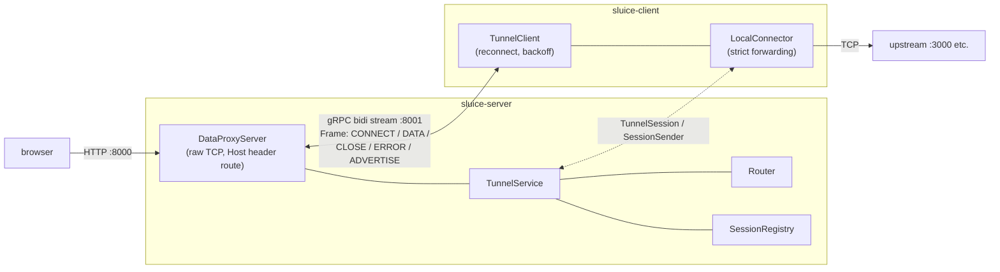
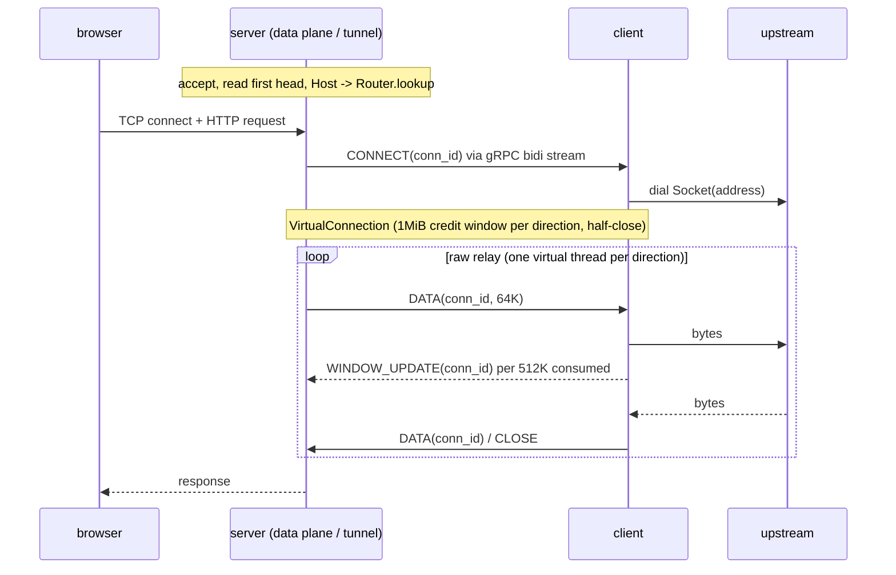
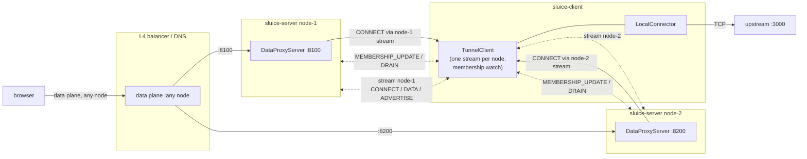

# sluice

HTTP tunnel over a gRPC bidirectional stream, built on Spring Boot 4.1 and Spring gRPC.

A single gRPC bidi stream multiplexes virtual TCP connections (`conn_id`). The data plane is a raw TCP proxy: the request head is inspected for routing (Host / :authority), so WebSocket upgrades and HTTP keep-alive pass through transparently. All blocking I/O runs on virtual threads; outbound frames are scheduled, not merely queued: control frames go first, connection frames wait on a per-connection bounded queue drained round-robin, and gRPC flow control is honored. Each virtual connection has its own credit window (1MiB per direction), so a connection whose reader stalls holds back only its own writer, never the stream.

## Architecture





- one bidi stream per client; each proxied TCP connection becomes a `conn_id` on that stream
- server: accept, route by `Host`, `VirtualConnection` + `CONNECT`, then raw relay (`SocketRelay`, one virtual thread per direction)
- client: `CONNECT`, dial the local upstream (strict forwarding), same raw relay; upstream URLs with `https://` are dialed with TLS (trust-all)
- flow control: bounded queues end to end; the gRPC send path honors `isReady()` on a dedicated sender thread, sends control frames before connection frames, and drains the per-connection queues round-robin so one busy connection cannot starve the others
- per-connection flow control (credit windows, as in HTTP/2 streams): each side announces a 1MiB receive window per connection (`Advertise` / `Connect`), and a writer sends only against the credit its peer granted back with `WINDOW_UPDATE`. The receive path never blocks, so one stalled connection does not stall the others on the stream; a peer sending past its window fails only that connection. Bounds: a receiver buffers at most one window per connection, window x connections in total (the number of connections is capped, see "Connection limits"); and one connection has at most one window in flight, so its throughput is at most window / RTT (about 20MiB/s at 50ms). A peer without the window is refused: the server fails the tunnel stream of a client announcing none with `FAILED_PRECONDITION` (sluice-client 046cd21 / sluice-wasmlet f76388d or later required), and the client and the wasmlet answer a CONNECT without one with an ERROR for that connection (sluice-server 046cd21 or later required); each rejection is logged once

## Modules

- `sluice-proto` - `.proto` contract, generated stubs, and the shared tunnel primitives (`VirtualConnection`, `SessionSender`, `SocketRelay`)
- `sluice-server` - exit node: gRPC control plane (`spring.grpc.server.port`, default 8001) + raw TCP data plane (`sluice.data-port`, default 8000) + actuator and management console (`server.port`, default 8081)
- `sluice-client` - tunnel client: connects to the server, advertises upstreams, dials local upstreams on CONNECT, reconnects with exponential backoff (1s..30s), actuator on `server.port` (default 9001)
- `sluice-it` - full stack integration tests running the real server and client applications in one JVM (proxying, reconnect after server restart, wrong-token rejection)
- `sluice-example-upstream` - minimal sample upstream for manual checks (`It works` over http/1.1 and h2c)

## Build

```
./mvnw verify
```

Requires JDK 25+. The `sluice-it` classes run in 6 JVMs at once (`-Dsluice.it.forks=N` to
change), a class at a time in each.

Build the executable jars first (the `-exec.jar` files below are produced by this):

```
./mvnw -DskipTests package
```

## Run

```
# terminal 1: upstream (sample server speaking http/1.1 and h2c on one port)
java -jar sluice-example-upstream/target/sluice-example-upstream-0.0.1-SNAPSHOT-exec.jar 31080

# terminal 2: server
java -jar sluice-server/target/sluice-server-0.0.1-SNAPSHOT-exec.jar \
  --sluice.token=SECRET

# terminal 3: client
java -jar sluice-client/target/sluice-client-0.0.1-SNAPSHOT-exec.jar \
  --sluice.server-url=grpc://127.0.0.1:8001 \
  '--sluice.client.upstream[0]'.host=demo.local \
  '--sluice.client.upstream[0]'.target=http://127.0.0.1:31080 \
  --sluice.token=SECRET

# terminal 4: request through the tunnel (routed by the Host header / :authority)
curl -H 'Host: demo.local' http://127.0.0.1:8000/
curl --http2-prior-knowledge -H 'Host: demo.local' http://127.0.0.1:8000/
```

`sluice.server-url` schemes: `grpc://` (plaintext) / `grpcs://` (TLS; `--sluice.insecure=true` skips
verification). For mutual TLS set `sluice.tls-bundle` to a `spring.ssl.bundle.pem.*` bundle whose
keystore holds the client certificate and whose truststore holds the CA of the server certificate;
on the server side pair `spring.grpc.server.ssl.bundle` with `spring.grpc.server.ssl.client-auth=REQUIRE`
and a truststore with the CA of the client certificates.

### Native image (client / server)

GraalVM native images (require a GraalVM JDK; AOT processing and `native-image` run in
the `package` phase):

```
./mvnw -pl sluice-client -am -Pnative -DskipTests package
./mvnw -pl sluice-server -am -Pnative -DskipTests package
sluice-client/target/sluice-client --sluice.server-url=grpc://127.0.0.1:8001 ...
sluice-server/target/sluice-server --sluice.token=SECRET ...
```

TLS termination on the data port (same upstream / server / client):

```
# self-signed cert registered as an SSL bundle, then restart the server with
#   --sluice.data-tls-bundle=data-plane
#   --spring.ssl.bundle.pem.data-plane.keystore.certificate=cert.pem
#   --spring.ssl.bundle.pem.data-plane.keystore.private-key=cert-key.pem
openssl req -x509 -newkey rsa:2048 -keyout cert-key.pem -out cert.pem -days 1 -nodes -subj /CN=localhost

# h2 over TLS (ALPN) / http/1.1 fallback / plaintext on the same port
curl --http2 -k -H 'Host: demo.local' https://127.0.0.1:8000/ -v -o /dev/null 2>&1 | grep 'using HTTP/2' -A2
curl --http1.1 -k -H 'Host: demo.local' https://127.0.0.1:8000/
```

TLS passthrough routed by SNI: see "SNI routing" below.

### Pre-built Docker images

Multi-arch (amd64 / aarch64) JVM and native images are published to ghcr.io on every push to
`main`: `ghcr.io/making/sluice/sluice-server:{jvm,native}` and
`ghcr.io/making/sluice/sluice-client:{jvm,native}` (immutable `jvm_<sha>` / `native_<sha>` tags too).

```
docker run --rm --pull always --name sluice-server -p 8000:8000 -p 8001:8001 -p 8081:8081 \
  ghcr.io/making/sluice/sluice-server:native --sluice.token=SECRET

docker run --rm --pull always --name sluice-client \
  -e SLUICE_SERVER_URL=grpc://host.docker.internal:8001 \
  -e SLUICE_TOKEN=SECRET \
  -e SLUICE_CLIENT_UPSTREAM_0_HOST=demo.local \
  -e SLUICE_CLIENT_UPSTREAM_0_TARGET=http://host.docker.internal:31080 \
  ghcr.io/making/sluice/sluice-client:native

curl -H 'Host: demo.local' http://127.0.0.1:8000/
```

Relaxed binding maps `SLUICE_SERVER_URL` / `SLUICE_TOKEN` /
`SLUICE_CLIENT_UPSTREAM_0_HOST` / `SLUICE_CLIENT_UPSTREAM_0_TARGET` to the properties above
(`host.docker.internal` reaches ports published on the host).

## TCP port routing

Upstreams with `listen-port` are routed by the listen port instead of the connection
head: the server opens one listener per advertised port and relays every accepted
connection verbatim -- no head parsing, no rewriting -- so any TCP protocol (ssh,
postgres, redis, ...) tunnels through, not just HTTP. Such an upstream is reached only
through its port: its `host` takes no part in Host / SNI routing on the data port, so it
neither captures http traffic for that host nor becomes the catch-all when empty.

```
# terminal 1: any TCP server, e.g. redis
redis-server --port 6379

# terminal 2: server (listeners bind on the data host)
java -jar sluice-server/target/sluice-server-0.0.1-SNAPSHOT-exec.jar \
  --sluice.token=SECRET

# terminal 3: client; the upstream target is a tcp:// URL
java -jar sluice-client/target/sluice-client-0.0.1-SNAPSHOT-exec.jar \
  --sluice.server-url=grpc://127.0.0.1:8001 \
  '--sluice.client.upstream[0]'.host=redis.local \
  '--sluice.client.upstream[0]'.target=tcp://127.0.0.1:6379 \
  '--sluice.client.upstream[0]'.listen-port=16379 \
  --sluice.token=SECRET

# terminal 4: connect to the advertised port
redis-cli -p 16379 ping
# -> PONG
```

The listener is bound when the client advertises and released on disconnect; the
server acknowledges the advertisement and reports back the listen ports it could
not bind (outside `sluice.tcp-port-range`, held by another connected client, or
already taken) -- the client keeps the stream (its other routes stay up) and
re-advertises on it with backoff (1s..30s) until the ports bind. The listen ports
must be exposed on the host (`docker -p`, firewall) -- the deployment delta against
the single data port.

## SNI routing

Where TCP port routing keys on the listen port, these two variants route a TLS
connection by the server name of its ClientHello:

- **TLS passthrough** (`sluice.client.upstream[n].tls-passthrough=true`): the data
  plane relays the TLS bytes untouched and routes by the ClientHello SNI; the upstream
  terminates TLS and presents its own certificate. The upstream target is a plain
  `tcp://` URL — the tunneled bytes are the already-encrypted TLS records.
- **TLS termination** (the default): the data plane terminates TLS (an SSL bundle via
  `sluice.data-tls-bundle` is required) and falls back to the SNI host name when the
  decrypted stream carries no HTTP `Host` header (any protocol works, e.g. RESP); the
  upstream target is then an everyday plaintext `tcp://` / `http://` URL.

Passthrough example, all four terminals:

```
# terminal 1: a TLS upstream (any TLS server works; here openssl's demo server
#   serving the current directory over HTTPS)
echo 'it-works-sni' > index.html
openssl req -x509 -newkey rsa:2048 -keyout cert-key.pem -out cert.pem -days 1 -nodes -subj /CN=demo.local
openssl s_server -accept 34443 -cert cert.pem -key cert-key.pem -WWW

# terminal 2: server (no TLS configuration on the data port)
java -jar sluice-server/target/sluice-server-0.0.1-SNAPSHOT-exec.jar \
  --sluice.token=SECRET

# terminal 3: client; tls-passthrough relays the TLS records as-is
java -jar sluice-client/target/sluice-client-0.0.1-SNAPSHOT-exec.jar \
  --sluice.server-url=grpc://127.0.0.1:8001 \
  '--sluice.client.upstream[0]'.host=demo.local \
  '--sluice.client.upstream[0]'.target=tcp://127.0.0.1:34443 \
  '--sluice.client.upstream[0]'.tls-passthrough=true \
  --sluice.token=SECRET

# terminal 4: request by SNI; --resolve sends ClientHello server_name=demo.local
#   to the data port
curl -k --resolve demo.local:8000:127.0.0.1 https://demo.local:8000/index.html
# -> it-works-sni
```

## Configuration (server)

| Property | Default | Description |
|---|---|---|
| `sluice.token` | (unset = auto-generated; the generated token is written to a temporary file whose path is logged) | bearer token for tunnel clients (`Authorization: Bearer <token>`, constant-time compare) |
| `sluice.token-file` | - | read the token from a file |
| `sluice.data-host` | `0.0.0.0` | bind address of the data plane |
| `sluice.data-port` | `8000` | data plane port |
| `sluice.data-tls-bundle` | - | SSL bundle name for data plane TLS termination (h2 / http/1.1 via ALPN, `force-http1` flips the preference); unset = plaintext only (TLS connections are served by upstreams with `tls-passthrough=true`) |
| `sluice.ca-bundle` | - | SSL bundle whose keystore holds the CA private key + certificate; enables client certificate issuance in the console (the signed certificates authenticate against the gRPC `client-auth=REQUIRE` truststore, no restart) |
| `sluice.proxy-protocol` | `false` | parse the PROXY protocol (v1 / v2) header an SNAT front end prepends on the data plane: the header is consumed before routing / relay (never forwarded) and its source address becomes the connection peer for access control and the access log; headerless connections are unaffected, a malformed header fails the connection |
| `sluice.limits.max-connections` | `0` = derived from the max heap | connections open at once over the data port and every tcp route port (an h2 connection counts once, whatever routes it reaches); see "Connection limits" |
| `sluice.limits.max-connections-per-address` | `0` = no limit beyond `max-connections` | connections open at once from one source address (the PROXY protocol source with `proxy-protocol=true`, the socket peer otherwise) |
| `sluice.limits.head-timeout` | `10s` | one deadline for the whole head phase of a data plane connection (PROXY header, TLS handshake, request head); on plaintext and TLS-terminated HTTP/1.1 it also bounds a later request head left incomplete between requests |
| `sluice.limits.idle-timeout` | `60s` | how long a plaintext or TLS-terminated HTTP/1.1 connection may idle between requests before it is closed (h2: none yet); see "Connection limits" |
| `sluice.limits.stall-timeout` | `60s` | how long a request or response in flight on a plaintext or TLS-terminated HTTP/1.1 connection may wait on its client without progress before the connection is closed (h2: none yet); see "Connection limits" |
| `sluice.limits.stall-min-bytes` | `16KB` | the bytes moved to or from the client that count as progress against `stall-timeout` (`1B`: every byte counts) |
| `sluice.limits.verbatim-idle-timeout` | `0` = off | how long a connection relayed verbatim (TLS passthrough, tcp route, hostless, upgraded HTTP/1.1) may relay no byte in either direction before it is closed, for the routes whose upstream sets no `verbatim-idle-timeout`; see "Connection limits" |
| `sluice.limits.tunnel-stall-timeout` | `60s` | how long a tunnel stream may hold frames queued for its client while not ready, the client taking none of them, before the session is failed; `0` = off; see "Connection limits" |
| `sluice.limits.half-close-probe-interval` | `1s` | quiet after which a plaintext or TLS-terminated HTTP/1.1 connection whose client ended its side, a response owed, gets a `100 Continue` to learn whether the client is gone; `0` = off; see "Connection limits" |
| `sluice.limits.h2-queue-budget` | `0` = an eighth of half the max heap | bytes the h2 demux relays may hold, both ways, beyond each connection's allowance, shared by all of them; see "Connection limits" |
| `sluice.limits.h2-stream-wait-timeout` | `30s` | how long an h2 stream may wait for a place within its upstream's `SETTINGS_MAX_CONCURRENT_STREAMS` before it is refused with `REFUSED_STREAM`; `0` = off; see "Connection limits" |
| `sluice.tcp-port-range` | (unset = any port) | listen ports a client may claim for tcp routes, comma separated single ports or `min-max` ranges (e.g. `9000-9010,8080`); a port outside the range is not bound |
| `sluice.http-load-balance` | `smallest-client-id` | target picked when several clients serve the same domain: `smallest-client-id` (deterministic across nodes) / `round-robin` (per node) / `random` |
| `sluice.tcp-load-balance` | `smallest-client-id` | target picked for tcp routes when several clients serve the same listen port (same values); the listen port bind itself always follows the smallest client id |
| `sluice.node.id` | hostname | cluster node id (logs, metrics, membership) |
| `sluice.node.public-url` | - | control plane address clients use for this node (e.g. `grpcs://sluice-0.example.com`); empty = reachable at the bootstrap address only |
| `sluice.cluster.nodes` | (empty = single-node) | cluster members, `nodeId=publicUrl` entries; see "Cluster (scale-out)" |
| `sluice.cluster.warmup` | `10s` | readiness stays down this long after start |
| `sluice.cluster.drain-grace` | `10s` | wait for in-flight virtual connections during drain |
| `sluice.cluster.membership-poll` | `10s` | membership re-read interval (pushed to clients on change) |
| `sluice.access-log.enabled` | `true` | emit access logs to the `sluice.access` logger (logfmt, INFO) |
| `sluice.access-log.types` | `connection,request` | comma separated event types: `connection` (accept/close with route, transport, bytes, duration) / `request` (every request head -- method, path, HTTP version, and the route it resolved to; on plaintext HTTP/1.1 keep-alive connections each request is parsed and routed, so a connection hopping hosts logs one `request` line per request) |
| `sluice.access-log.rate-limit.enabled` | `true` | rate limit access log lines per line kind, syslog style (as in `rate-limited-logger`) |
| `sluice.access-log.rate-limit.max-rate` | `10` | max lines emitted per line kind (`conn-accept` / `conn-close` / `conn-reject` / `request`) within one period; the line that reaches the limit is still emitted |
| `sluice.access-log.rate-limit.period` | `10s` | rate limit window; lines beyond the limit are counted and one `type=ratelimit` summary line reports the suppressed count when the period rolls over |
| `sluice.access-control.allow-cidrs` | (empty = every address) | data plane IP allow list, literal IPv4/IPv6 CIDRs or bare addresses; denied connections get 403 (http routes) or a plain close (tcp routes / TLS passthrough) |
| `sluice.access-control.deny-cidrs` | (empty) | data plane IP deny list, evaluated before any allow list and never overridden |
| `sluice.access-control.trusted-proxy-cidrs` | (empty = the peer address is judged) | peers trusted as proxying load balancers: when the connection peer matches, the rightmost `X-Forwarded-For` entry (the one the proxy appended) is judged instead of the peer address; the LB must be configured to append to the header, client-sent entries stay part of the chain |
| `spring.grpc.server.port` | `8001` | gRPC control plane port |
| `server.port` | `8081` | actuator (health / info / prometheus) and the management console (`/console`) |
| `sluice.console.auth.type` | `simple` | console authentication: `simple` (form login with `spring.security.user.name` / `spring.security.user.password`) / `oidc` (OpenID Connect via `spring.security.oauth2.client.*`; see "Console authentication") |

## Configuration (client)

| Property | Default | Description |
|---|---|---|
| `sluice.server-url` | - | tunnel server endpoint (`grpc://host:port` / `grpcs://host:port`) |
| `sluice.client.id` | random, once per process | stable client identity sent as `x-sluice-id` on every stream; breaks route / listen-port ties in cluster mode |
| `sluice.client.max-connections` | `0` = derived from the max heap | upstream connections open at once over every server node; a `CONNECT` beyond it is answered with an ERROR without dialing |
| `sluice.client.tunnel-stall-timeout` | `60s` | how long a tunnel stream may hold frames queued for the server while not ready, the server taking none of them, before the stream is cancelled and reconnected; `0` = off; see "Connection limits" |
| `sluice.client.upstream[n].host` | - | public domain routed by the server (empty = catch-all) |
| `sluice.client.upstream[n].host-pattern` | - | regular expression the request host (without its port) is matched against, whole match; tried after the exact matches, before the catch-all, in natural order; overrides `host` when set |
| `sluice.client.upstream[n].target` | - | upstream URL: `http://` (default when the scheme is omitted), `https://` (TLS terminated by the client), or `tcp://` (raw relay, e.g. a TLS endpoint in passthrough mode) |
| `sluice.client.upstream[n].rewrite-host` | `false` | rewrites the request Host / `:authority` to the target's `host[:port]` |
| `sluice.client.upstream[n].tls-passthrough` | `false` | TLS connections for the upstream are relayed untouched (routed by ClientHello SNI, the upstream terminates TLS) instead of terminated on the data plane |
| `sluice.client.upstream[n].force-http1` | `false` | the upstream speaks HTTP/1.1 only: the data plane's TLS termination prefers http/1.1 in ALPN for the route, and an h2 stream for it (a browser coalescing the host onto an h2 connection of another host, an h2-only or h2c client) gets `421 Misdirected Request`; `tls-passthrough` routes are unaffected |
| `sluice.client.upstream[n].listen-port` | `0` | public port the server listens on for this upstream; connections are relayed as raw TCP routed by the listen port -- no head parsing, no rewriting -- so any protocol (ssh, postgres, redis, ...) tunnels through. The listener is bound on advertise and released on disconnect; bind it on the host (`docker -p`, firewall) to expose it |
| `sluice.client.upstream[n].allowed-cidrs` | (empty = the server-wide `sluice.access-control.allow-cidrs` applies) | CIDRs / bare addresses allowed to connect to this upstream on the data plane; replaces the server-wide allow list for the route (the deny list still applies) |
| `sluice.client.upstream[n].verbatim-idle-timeout` | `0` = the server's `sluice.limits.verbatim-idle-timeout` applies | how long a connection of this upstream relayed verbatim (TLS passthrough, tcp route, hostless, upgraded HTTP/1.1) may relay no byte in either direction before the server closes it; replaces the server's default for the route; see "Connection limits" |
| `sluice.token` / `sluice.token-file` | - | authentication token |
| `sluice.insecure` | `false` | skip TLS verification |
| `sluice.tls-bundle` | - | SSL bundle for the `grpcs://` control plane connection: keystore = client certificate (mutual TLS), truststore = CAs to verify the server; takes precedence over `sluice.insecure` |
| `sluice.keep-alive-time` | `30s` | interval of the gRPC keepalive ping towards the server |
| `sluice.keep-alive-timeout` | `10s` | how long a keepalive ping answer may take before the channel is torn down |
| `sluice.strict-forwarding` | `true` | only dial upstreams present in the map |
| `server.port` | `9001` | actuator (health / info / prometheus) |

## gRPC keepalive

The tunnel is one long-lived gRPC stream; NAT / load balancers silently drop idle
connections, so both sides keep it warm with HTTP/2 pings and the server-side values are
set explicitly in `sluice-server/src/main/resources/application.properties`:

| Setting | Value | Reason |
|---|---|---|
| server `spring.grpc.server.keepalive.time` / `spring.grpc.server.keepalive.timeout` | `30s` / `10s` | the server pings clients and reaps dead ones (session and routes released ~40s after silent death) |
| server `spring.grpc.server.keepalive.permit.time` / `spring.grpc.server.keepalive.permit.without-calls` | `10s` / `true` | client pings every 30s; grpc's default permit (5m) risks `GOAWAY TOO_MANY_PINGS` |
| client `sluice.keep-alive-time` / `sluice.keep-alive-timeout` | `30s` / `10s` | pings keep NAT mappings alive; an unanswered ping tears the channel down and the reconnect backoff (1s..30s) takes over |

Application-level `KEEPALIVE` frames are not sent: the gRPC (HTTP/2) ping already
provides liveness. The frame type stays in the proto for future use and is handled as a
no-op on both sides. `GrpcKeepAliveTest` (sluice-it) guards the behavior with a 1s-ping
channel.

## Cluster (scale-out)

Run N server nodes: every client keeps one tunnel stream to every node, so each node holds
the full route table locally -- no shared store, no inter-node hop.

Deployment requirements (independent of the front end):

- each node's control plane is reachable from clients at its own address (per-node URL)
- data plane connections may land on any node (plain L4 balancing is enough)

```
# terminal 1/2: two nodes sharing one membership list and token
java -jar sluice-server/target/sluice-server-0.0.1-SNAPSHOT-exec.jar \
  --sluice.token=SECRET --sluice.node.id=node-1 \
  --spring.grpc.server.port=8101 --sluice.data-port=8100 --server.port=18180 \
  --sluice.cluster.nodes=node-1=grpc://127.0.0.1:8101,node-2=grpc://127.0.0.1:8201
java -jar sluice-server/target/sluice-server-0.0.1-SNAPSHOT-exec.jar \
  --sluice.token=SECRET --sluice.node.id=node-2 \
  --spring.grpc.server.port=8201 --sluice.data-port=8200 --server.port=18181 \
  --sluice.cluster.nodes=node-1=grpc://127.0.0.1:8101,node-2=grpc://127.0.0.1:8201

# terminal 3: client -- server-url is only the bootstrap; the node list is learned
# via ListNodes and one stream is opened per node
java -jar sluice-client/target/sluice-client-0.0.1-SNAPSHOT-exec.jar \
  --sluice.server-url=grpc://127.0.0.1:8101 --sluice.client.id=client-1 \
  '--sluice.client.upstream[0]'.host=demo.local \
  '--sluice.client.upstream[0]'.target=http://127.0.0.1:31080 \
  --sluice.token=SECRET

# terminal 4: either node serves the route
curl -H 'Host: demo.local' http://127.0.0.1:8100/
curl -H 'Host: demo.local' http://127.0.0.1:8200/
```



Each node routes with its own full copy of the route table (every client advertises to
every node), so the data plane never hops between nodes.

Behavior:

- membership: `sluice.cluster.nodes` lists the members as `nodeId=publicUrl` entries (the
  local node is always included). It is pushed to every client on connect and whenever it
  changes (`MEMBERSHIP_UPDATE` frame); the client opens/closes per-node streams accordingly.
  A node with an empty public url is reachable at the address the client bootstrapped with
- routing: a domain (or listen port) claimed by several clients is served by the one with
  the smallest `sluice.client.id` -- deterministically on every node, since every node sees
  every client. A smaller id takes over a bound listen port on advertise; a larger id gets
  the port rejected and retries on the same stream
- lifecycle: readiness (`/actuator/health/readiness`) is DOWN for `sluice.cluster.warmup`
  after start (clients connect first) and while draining. On shutdown the node sends a
  `DRAIN` frame, waits up to `sluice.cluster.drain-grace` for in-flight virtual connections
  to finish, then closes the streams. Clients keep their other nodes' streams and retry the
  drained node with backoff
- configuration: cluster mode refuses to start without an explicit `sluice.token` /
  `sluice.token-file` (per-node random tokens would break clients connected to every node)
- observability: every metric carries a `node` common tag; the client health details show
  the per-node stream states

Without `sluice.cluster.nodes` the server runs single-node and nothing above applies
(`ListNodes` returns just the node itself).

## Cluster (TLS)

The control plane can serve TLS (`spring.grpc.server.ssl.bundle`), so a front end routes
per node by SNI without terminating TLS. Verified end to end with a self-signed certificate;
no code difference from the plaintext cluster, only configuration:

```
# self-signed cert for the gRPC control plane
openssl req -x509 -newkey rsa:2048 -keyout grpc-key.pem -out grpc-cert.pem -days 1 -nodes -subj /CN=localhost

# terminal 1/2: same cluster as above, plus the TLS bundle on every node
java -jar sluice-server/target/sluice-server-0.0.1-SNAPSHOT-exec.jar \
  --sluice.token=SECRET --sluice.node.id=node-1 \
  --spring.grpc.server.port=8101 --sluice.data-port=8100 --server.port=18180 \
  --sluice.cluster.nodes=node-1=grpcs://127.0.0.1:8101,node-2=grpcs://127.0.0.1:8201 \
  --spring.grpc.server.ssl.bundle=grpc-control \
  --spring.ssl.bundle.pem.grpc-control.keystore.certificate=file:grpc-cert.pem \
  --spring.ssl.bundle.pem.grpc-control.keystore.private-key=file:grpc-key.pem
java -jar sluice-server/target/sluice-server-0.0.1-SNAPSHOT-exec.jar \
  --sluice.token=SECRET --sluice.node.id=node-2 \
  --spring.grpc.server.port=8201 --sluice.data-port=8200 --server.port=18181 \
  --sluice.cluster.nodes=node-1=grpcs://127.0.0.1:8101,node-2=grpcs://127.0.0.1:8201 \
  --spring.grpc.server.ssl.bundle=grpc-control \
  --spring.ssl.bundle.pem.grpc-control.keystore.certificate=file:grpc-cert.pem \
  --spring.ssl.bundle.pem.grpc-control.keystore.private-key=file:grpc-key.pem

# terminal 3: client -- grpcs:// bootstrap, insecure trusts the self-signed cert;
# membership URLs (grpcs://) are dialed with the same setting
java -jar sluice-client/target/sluice-client-0.0.1-SNAPSHOT-exec.jar \
  --sluice.server-url=grpcs://127.0.0.1:8101 --sluice.insecure=true --sluice.client.id=client-1 \
  '--sluice.client.upstream[0]'.host=demo.local \
  '--sluice.client.upstream[0]'.target=http://127.0.0.1:31080 \
  --sluice.token=SECRET

# terminal 4: both nodes serve over their TLS control planes
curl -H 'Host: demo.local' http://127.0.0.1:8100/
curl -H 'Host: demo.local' http://127.0.0.1:8200/

# the control plane negotiates h2 via ALPN
echo | openssl s_client -connect 127.0.0.1:8101 -alpn h2 2>/dev/null | grep 'ALPN protocol'
```

E2E coverage: `ClusterGrpcTlsE2ETests` (sluice-it) -- both nodes serve, failover after a
node stops, and h2 negotiation on the TLS endpoint.

## Mutual TLS (server <-> client)

The server requires a client certificate (`client-auth=REQUIRE`) and the client presents one
from an SSL bundle (`sluice.tls-bundle`); no `sluice.insecure` needed. Example with a local CA:

```sh
# a private CA and two leaf certificates signed by it
openssl req -x509 -newkey rsa:2048 -nodes -keyout ca-key.pem -out ca.pem \
  -days 3650 -subj /CN=sluice-ca -addext basicConstraints=critical,CA:TRUE
openssl req -newkey rsa:2048 -nodes -keyout server-key.pem -out server.csr -subj /CN=localhost
openssl x509 -req -in server.csr -CA ca.pem -CAkey ca-key.pem -days 3650 \
  -extfile <(printf 'subjectAltName=DNS:localhost,IP:127.0.0.1\n') -out server-cert.pem
openssl req -newkey rsa:2048 -nodes -keyout client-key.pem -out client.csr -subj /CN=sluice-client
openssl x509 -req -in client.csr -CA ca.pem -CAkey ca-key.pem -days 3650 -out client-cert.pem
openssl verify -CAfile ca.pem server-cert.pem client-cert.pem
```

```sh
# server: terminate TLS on the control plane and require client certificates
java -jar sluice-server/target/sluice-server-0.0.1-SNAPSHOT-exec.jar \
  --sluice.token=SECRET --spring.grpc.server.port=8001 --sluice.data-port=8000 \
  --spring.grpc.server.ssl.bundle=grpc-control \
  --spring.grpc.server.ssl.client-auth=REQUIRE \
  --spring.ssl.bundle.pem.grpc-control.keystore.certificate=file:server-cert.pem \
  --spring.ssl.bundle.pem.grpc-control.keystore.private-key=file:server-key.pem \
  --spring.ssl.bundle.pem.grpc-control.truststore.certificate=file:ca.pem

# client: keystore = the client certificate, truststore = the CA that signed the server cert
java -jar sluice-client/target/sluice-client-0.0.1-SNAPSHOT-exec.jar \
  --sluice.server-url=grpcs://127.0.0.1:8001 --sluice.tls-bundle=grpc-client --sluice.client.id=client-1 \
  '--sluice.client.upstream[0]'.host=demo.local \
  '--sluice.client.upstream[0]'.target=http://127.0.0.1:31080 \
  --spring.ssl.bundle.pem.grpc-client.keystore.certificate=file:client-cert.pem \
  --spring.ssl.bundle.pem.grpc-client.keystore.private-key=file:client-key.pem \
  --spring.ssl.bundle.pem.grpc-client.truststore.certificate=file:ca.pem \
  --sluice.token=SECRET
```

The client bundle is applied to every node connection (the bootstrap and the membership
`grpcs://` URLs alike). `client-auth` also accepts `OPTIONAL` / `WANT` / `NONE`.

E2E coverage: `ClusterGrpcMutualTlsE2ETests` (sluice-it) -- mTLS to both nodes with failover,
rejection of a certificate-less client, a certificate issued through the console
(`sluice.ca-bundle`), and TLS termination / passthrough on the data plane over the mTLS
tunnel.

## Connection limits

The data port and every tcp route port share one limit on the connections open at once
(`sluice.limits.max-connections`), taken at accept: a connection beyond it is closed
unread. `sluice.limits.max-connections-per-address` caps one source address; it is off by
default because behind an SNAT front end without the PROXY protocol every connection
carries the front end's address. `sluice.limits.head-timeout` is one deadline for the
whole head phase (PROXY header, TLS handshake, request head), not a timeout per read, so a
peer dripping its head is cut as well. Rejected connections are logged as rate-limited
`type=conn event=reject` access log lines. The client caps its upstream connections over
every node (`sluice.client.max-connections`): a `CONNECT` beyond it gets an ERROR without a
dial, and the server closes the public connection.

A plaintext or TLS-terminated HTTP/1.1 connection idle between requests is closed after
`sluice.limits.idle-timeout`, releasing its slot: once every response is relayed and
nothing of a next request has arrived (a next request head left incomplete is then cut by
`head-timeout`). A response taking longer than the timeout is not cut, nor is an upgraded
connection (WebSocket; a connection whose upgrade the upstream declines stays HTTP). An h2
connection has no idle timeout yet: a client may hold an idle h2 connection, and its
slot, open for good. Behind a front end that reuses its connections to the data plane, set the timeout above
the front end's idle timeout, so the front end closes an idle connection before sluice
does. Connections closed so count as
`sluice.data.connections.idle.closed`.

While a request or response is in flight on such an HTTP/1.1 connection,
`sluice.limits.stall-timeout` bounds the time the relay waits on the client without
`sluice.limits.stall-min-bytes` moving to or from it (the counterpart of nginx
`send_timeout` / `client_body_timeout`, with a minimum rate): a write to the client not
completing (it does not read), or a request body announced by `Content-Length` or chunked
that is due and not sent. A client dripping bytes below the minimum is cut as if it sent
none. The connection is closed and counted as `sluice.data.connections.stall.closed`.
Waiting for an upstream does not count: a slow or long-polling response, an upload the
upstream does not read yet. Nor does a client awaiting a `100 Continue` it asked for (until
a response head or a byte of its body). The time waited is checked eight times per
timeout, so a stall is cut up to a quarter of the timeout past it. Write progress is what
the client's TCP stack accepts: once the buffers towards a client that reads slowly have
filled up, a blocked write may return long after the client resumed reading (observed on
Linux loopback: only once the client drained about 900KB), so keep the timeout well above
such gaps. The relay writes in 16KiB pieces, each counted as progress once it completes. A
client streaming small pieces slower than the minimum is cut too: set
`stall-min-bytes=1B` to count every byte, or raise the timeout. h2 connections have no
stall timeout yet, and connections relayed verbatim keep none; see the verbatim idle
timeout below.

A connection relayed verbatim -- TLS passthrough, a tcp route, a hostless connection (a
RESP head, plaintext or TLS-terminated), an upgraded HTTP/1.1 connection (a WebSocket,
say) -- has no request boundaries, so neither `idle-timeout` nor `stall-timeout` applies
to it. It is bounded by the verbatim idle timeout instead: once no byte was read from the
client nor written to it for the timeout, the connection is closed, its slot released, and
counted as `sluice.data.connections.verbatim.idle.closed`. Bytes flowing in one direction
keep it open. A connection half-closed by its upstream stays under the timeout, as does
one whose client stopped reading: the relay's write to it blocks, nothing more is written,
and the timeout closes the connection under the blocked write (a TLS-terminated one after
the one-second teardown grace, should the relay's teardown wait on that write). A write
counts as each of its 16KiB pieces completes. What idles legitimately depends on the
protocol (a Redis or database pool keeps connections idle for minutes), so the timeout is
set per route by the client operator, `sluice.client.upstream[n].verbatim-idle-timeout`;
`sluice.limits.verbatim-idle-timeout` applies to the routes that set none, so a server
operator can bound every route. A route's own timeout replaces the server's, longer or
shorter; a route cannot turn the server's off. Both are off by default: a peer that goes
quiet on a connection relayed verbatim, or stops reading from it, then holds its slot of
`max-connections` (and of `max-connections-per-address`) until it or the upstream closes
the connection.

The plaintext and TLS-terminated HTTP/1.1 relay reads request and response heads as
ISO-8859-1, so a field value carrying non-ASCII bytes (a UTF-8 header value, RFC 9110
obs-text) is routed, rewritten and tracked like any other, its bytes relayed as is. A
request it cannot follow is malformed: a head over 64KiB, a line not ended by CRLF, a bare
CR, a NUL, a malformed request line, a field line folded, whose name is not a token
(whitespace before the colon included) or whose value holds a control character other
than HTAB, more than one `Host`, a `Content-Length` that
is not one decimal number, a `Transfer-Encoding` whose final coding is not `chunked` or that
comes with a `Content-Length`, and a chunk-size line, chunk terminator or trailer section
out of the chunked syntax. Since the upstream might frame such bytes differently (request
smuggling), nothing of the malformed request or after it is relayed: once the responses to
the requests before it are relayed, the client gets `400 Bad Request` -- unless the
upstream already began answering the malformed request on its head -- and the connection is
closed, after reading what the client still sends for up to 2s, so the 400 is not lost to
a reset. A first request head with a `Host` header but no valid request line is
answered 400 too. A response whose framing the relay cannot follow (a head over 64KiB or
without a status code, an invalid `Content-Length` or chunk-size line) is relayed as an
unframed one: it ends, and the connection with it, when the upstream closes.

A client's FIN does not tell whether it half-closed or left: HTTP/1.1 lets a half-closed
client still wait for its response (RFC 9112 9.6), and only a write fails on a client gone.
So once a plaintext or TLS-terminated HTTP/1.1 client ended its side while a response is
owed and none of it relayed, the relay writes `HTTP/1.1 100 Continue` after each
`sluice.limits.half-close-probe-interval` without a write to the client or a request
relayed, at most four per response. A client gone fails the second write: the relay ends,
fails its tunnel connection, and the client closes the upstream connection. A client that
only half-closed reads the 100s, then its response. A gone client is not noticed, and is
held until the upstream answers or closes (for a wasmlet route, its request budget), once
a response has begun (nothing can be added to it), towards an HTTP/1.0 request (which must
not get a 1xx), while a request asking for an upgrade awaits its answer (the relay reads
nothing from the client meanwhile), and after the four probes. `0` turns the probe off. The h2
demux has no such probe yet.

The clients measured (curl, wget, Go, the JDK `HttpClient` and `HttpURLConnection`,
Python's `http.client`, Node's `http` and `fetch`) do not half-close after a request, so a
live client that gets a probe half-closed on purpose (`nc`-style tools). No 1xx suits every
client: Node's `fetch` (undici 7.28) fails on an unsolicited 100, while Python's
`http.client` and `HttpURLConnection` before JDK 20 mishandle a 102 or 103 as the final
response; the others skip a 100 too. Go before 1.24 fails a response at its sixth 1xx and
the JDK `HttpClient` at its ninth, hence four.

The most one relayed connection buffers on each side of the tunnel is its receive buffer
+ its send queue cap (16 x 64KiB = 1MiB) + the two relay buffers (2 x 64KiB) = 2.16MiB.
The receive buffer holds at most the 1MiB window of unread payload, coalesced into 16KiB
segments whatever the size of the DATA frames, plus 37KiB: a partly read and a partly
filled segment, and the overhead of at most 80 segments.

h2 (plaintext and TLS-terminated) is demultiplexed on netty's HTTP/2 codec: the relay
is the HTTP/2 endpoint of the client connection and a client of one upstream connection
-- a virtual connection -- per route the connection reaches, all of them on the
connection's own slot of `sluice.limits.max-connections` (a further upstream connection
takes no slot of its own yet). A stream beyond the upstream's
`SETTINGS_MAX_CONCURRENT_STREAMS` (one until the upstream's first SETTINGS) waits in the
relay, for the same upstream connection, until one of the streams there closes; a stream
still waiting after `sluice.limits.h2-stream-wait-timeout` (30s; `0` = off) is refused
with `REFUSED_STREAM`, its upstream never having seen it, so an upstream that keeps its
streams open or announces a limit of 0 does not hold it for good.

The windows are per hop. The relay announces a 64KiB stream window to the client and to
each upstream, grants a stream's window back only for what it wrote on the other hop, and
refills its connection windows as DATA arrives (a connection window is granted back once
half of it is spent, exactly what was spent): a stream held by its upstream or by its
client holds at most one stream window in the relay, and the connection's other streams
go on, on the same upstream connection too. DATA held for a stream is copied into one
buffer rounded up to 1KiB, however small the frames. What the relay holds -- that DATA
and the header blocks not yet written, both ways, plus the writer queue of the client
connection and of each upstream connection -- is bounded across connections: each
connection may hold 128KiB, and the bytes beyond it are charged to
`sluice.limits.h2-queue-budget`, shared by every h2 connection. Past its 128KiB with the
budget exhausted, the relay withholds the connection window of the client and of every
upstream connection (a peer stops once the at most 64KiB it holds are spent) until the
connection drains below 128KiB or the budget has room again; a new stream whose head
does not fit is refused with `REFUSED_STREAM`, and a later header block that does not fit
resets its stream (`RST_STREAM` `ENHANCE_YOUR_CALM` to the client, `CANCEL` to the
upstream) while the connection's other streams go on: the client's trailers, and an
upstream's interim (1xx) head, final head or trailers once the client connection's writer
queue, with the upstreams' header blocks waiting for it, holds 256KiB (so a response is
not held back for bytes queued towards the upstreams). A header block counts at its size
as HPACK counts it (RFC 7541 4.1), not at the bytes it took on the wire: one referring to
the peer's dynamic table, a few bytes on the wire, counts about what the relay writes for
it, up to 64KiB. The interim heads of one response may sum to 64KiB counted so (the header
list limit); the one past it is not relayed: the upstream's stream is reset with
`ENHANCE_YOUR_CALM` and the client gets the bad-gateway page (`502`). While the window is
withheld, the streams waiting for an upstream's concurrency limit hold at most 128KiB of
the connection: past it the
most recent of them are refused with `REFUSED_STREAM` (their upstream never saw them; the
client may retry them), since their bytes drain only once a stream ahead of them closes,
which may need the very request body the withheld window holds back. So a connection
whose peers read keeps flowing however exhausted the budget is. A connection then holds
outside the budget its 128KiB, what its client still sends (the 16KiB read under way,
64KiB of window, under 1KiB of rounding per stream: 180KiB) and its client connection's
writer queue (a connection is no longer read past 256KiB queued, plus at most 64KiB:
320KiB), about 628KiB (`NettyHttp2DemuxRelay.UNBUDGETED_BYTES`); each upstream connection
adds its upstream's 180KiB and its own 320KiB writer queue, about 500KiB
(`NettyHttp2DemuxRelay.RESPONSE_QUEUE_BYTES`). Not covered yet: every upstream connection
of an h2 connection opens on the connection's own slot, so one reaching several routes
holds 500KiB per further route beyond its slot's worst case.

An unset (`0`) budget is an eighth of half the max heap, and an unset (`0`) connection
limit is derived so that the worst case of every slot (2.16MiB + 628KiB + 500KiB) and the
budget fit in half the max heap: `max(1, (max heap / 2 - budget) / 3.26MiB)`, e.g. 53 for a 400MiB heap, 549 for
4GiB. The effective values are logged at startup (`data plane
connection limit` / `upstream connection limit`) and exported as gauges; with the 512Mi
container of `k8s.md` they follow the heap the server gets there.

A slot is released only once its connection ended and the frames it queued for the tunnel
stream left the sender, on the server as on the client (`sluice.client.max-connections`);
the end of the tunnel session drops the frames and releases their slots. An h2
connection keeps its slot until the frames each of its upstream connections queued left
the same way, and an HTTP/1.1 connection switching routes sends nothing to
the new route until the frames queued for the previous one left. So the send queues of
ended connections stay within the bound; while a stream stays not ready, their slots stay
taken until it drains or the session ends.

A peer that stops reading the tunnel stream while it keeps the connection alive (it answers
the keepalive pings) would hold those slots for good, so a progress watchdog bounds the
wait on both sides: once connection frames waited `sluice.limits.tunnel-stall-timeout`
(server) / `sluice.client.tunnel-stall-timeout` (client) with the stream not ready and none
of them handed to it, the sender drops its queued frames, which frees their slots, and the
stream is reset: the server fails the session (its routes are removed and its live
connections fail with it, the client reconnects), the client cancels the stream and
reconnects. A frame handed to the stream restarts the wait, so a peer that reads slowly but
keeps taking frames is not cut; control frames, which bypass flow control, do not count, and
with no connection frame queued nothing is stalled. The time stalled is exported as
`sluice.tunnel.stall`, the streams failed as `sluice.tunnel.stall.failures`. No share of the
server's slots is reserved per client: tunnel clients are authenticated, and the watchdog
bounds how long one can hold slots.

## Health / metrics

- server `GET /actuator/health` - liveness, UP while the process lives; details `clients`
  (connected tunnel clients) and `draining`. `/actuator/health/readiness` is DOWN during the
  cluster warmup window and while draining (see "Cluster (scale-out)")
- client `GET /actuator/health` (port 9001) - UP while at least one per-node tunnel stream is
  established; the `tunnel` detail shows the connection state and `nodes` each node's stream state
- `GET /actuator/prometheus` - JVM metrics plus `sluice_tunnel_bytes_total`, `sluice_connections_active`, `sluice_reconnect_total`, `sluice_tunnel_window_updates_total` (per-connection credit grants, `direction` = `sent` / `received`), `sluice_tunnel_stall_seconds` (how long a tunnel stream has held frames queued for its peer, not ready, with none taken; on the server the most stalled session's, 0 when none) / `sluice_tunnel_stall_failures_total` (tunnel streams failed by the stall watchdog), `sluice_connections_limit` / `sluice_connections_admitted` / `sluice_connections_rejected_total` (client connection limit), and on the server `sluice_tunnel_sessions_build_unknown` (connected clients without a build, see "Console"), `sluice_h2demux_queued_bytes` (bytes the h2 demux holds of a route's streams, both ways, plus the upstream connections' writer queues, one series per route), `sluice_h2demux_budget_bytes` / `sluice_h2demux_budget_used_bytes` (the shared h2 queue budget and the bytes charged to it, which may pass the budget by what the relays cannot refuse), `sluice_h2demux_window_withheld_total` (times a connection window was withheld for want of budget), `sluice_h2demux_streams_refused_total` (`reason` = `budget` / `waiting`: a stream waiting for its upstream's concurrency limit refused to free a connection whose window is withheld / `wait-timeout`: one refused past `sluice.limits.h2-stream-wait-timeout`), `sluice_h2demux_streams_reset_total` (streams the relay reset on its own account, `reason` = `budget`: a header block that did not fit the budget / `interim`: an upstream's interim heads past 64KiB), `sluice_h2demux_streams_misdirected_total` (streams answered `421`, `reason` = `force-http1`) and `sluice_data_connections_limit` / `sluice_data_connections_admitted` / `sluice_data_connections_rejected_total` (`reason` = `limit` / `address-limit` / `head-timeout`) / `sluice_data_connections_idle_closed_total` (connections closed for idling between requests) / `sluice_data_connections_stall_closed_total` (connections closed for an exchange stalled on its client)

## Console

`http://<server>:8081/console` (the actuator port) shows the live state of one node: the
public listeners, connected clients with their build, upstreams and traffic, the http / tcp route
tables with the client each route resolves to, the cluster membership and the effective
settings. A "Find a route" box tells which client serves a given Host header without
touching load balancing state. The page refreshes every 2s.

Each client row shows the build the client (Java client or wasmlet) announced in its
`Advertise`: implementation, version and short commit, with the full commit and build time on
hover. A client that predates build reporting shows `Unknown (older build)`; the gauge
`sluice_tunnel_sessions_build_unknown` counts them per node.
The server logs each client's build at its first `Advertise`; the Java client logs the server's
build when its stream comes up.

### Client certificate issuance

With a CA configured, the console issues client certificates for the mTLS control plane:
the `Client certificate` panel links to `/console/certificates`, where a common name and
validity produce a zip download with three PEM files -- `<name>.crt.pem`,
`<name>.key.pem` (PKCS#8) and `ca.crt.pem` -- mapping one to one onto the
`sluice.tls-bundle` keystore / private-key / truststore properties. No server restart is
needed -- the control plane truststore already pins the CA:

```properties
# sluice.ca-bundle=console-ca
# spring.ssl.bundle.pem.console-ca.keystore.private-key=file:ca-key.pem
# spring.ssl.bundle.pem.console-ca.keystore.certificate=ca.pem
```

The panel and the page are read-only until `sluice.ca-bundle` is set. Keys are created on
the server at issuance time (no CSR handling); revocation and renewal are out of scope.

### Console authentication

The console requires a signed-in user; the actuator endpoints and the console static
assets stay open. The mechanism is `sluice.console.auth.type`:

- `simple` (default): form login with `spring.security.user.name` /
  `spring.security.user.password` (`{noop}` / `{bcrypt}` prefixed values supported), e.g.
  `docker run ... -e SPRING_SECURITY_USER_NAME=admin -e SPRING_SECURITY_USER_PASSWORD='{noop}secret'`
- `oidc`: sign in through an OpenID Provider, configured with the standard
  `spring.security.oauth2.client.*` properties

```properties
# Enable OIDC authentication
sluice.console.auth.type=oidc

# Configure Google as the identity provider
spring.security.oauth2.client.provider.google.issuer-uri=https://accounts.google.com
spring.security.oauth2.client.provider.google.user-name-attribute=email
spring.security.oauth2.client.registration.google.client-id=your-google-client-id
spring.security.oauth2.client.registration.google.client-secret=your-google-client-secret
spring.security.oauth2.client.registration.google.client-name=Google
spring.security.oauth2.client.registration.google.scope=openid,email

# Configure Microsoft Entra ID (formerly Azure AD) as another provider
spring.security.oauth2.client.provider.microsoft-entra-id.issuer-uri=https://sts.windows.net/{tenant-id}/
spring.security.oauth2.client.provider.microsoft-entra-id.user-name-attribute=email
spring.security.oauth2.client.registration.microsoft-entra-id.client-id=your-client-id
spring.security.oauth2.client.registration.microsoft-entra-id.client-secret=your-client-secret
spring.security.oauth2.client.registration.microsoft-entra-id.client-name=Microsoft Entra ID
spring.security.oauth2.client.registration.microsoft-entra-id.scope=openid,email
```

Multiple providers can be configured simultaneously; the login page shows one button per
provider. Register the redirect URI `http://<server>:8081/login/oauth2/code/<registration-id>`
at the provider (e.g. `.../login/oauth2/code/google` for the configuration above).

Signing out of the console also ends the session at the provider (RP-initiated logout) when
its discovery document advertises an `end_session_endpoint`; register
`http://<server>:8081/login?logout` as the post-logout redirect URI. Providers without one
(e.g. Google) end only the console session.

## Docker

Images are built with Cloud Native Buildpacks (Spring Boot plugin, no Dockerfile). Build deps
first, then the app module only -- running `build-image` on the reactor also hits the library
modules. Append `-Pnative` for GraalVM native images:

```
./mvnw -pl sluice-server -am package spring-boot:build-image -DskipTests
./mvnw -pl sluice-client -am package spring-boot:build-image -DskipTests

./mvnw -pl sluice-server -am -Pnative -DskipTests package
./mvnw -pl sluice-server -Pnative -DskipTests spring-boot:build-image   # native image
./mvnw -pl sluice-client -am -Pnative -DskipTests package
./mvnw -pl sluice-client -Pnative -DskipTests spring-boot:build-image   # native image
```

This produces `sluice-server:latest` and `sluice-client:latest`. Run:

```
docker run -p 8000:8000 -p 8001:8001 sluice-server --sluice.token=SECRET
docker run sluice-client --sluice.server-url=grpc://host.docker.internal:8001 \
  '--sluice.client.upstream[0]'.host=demo.local '--sluice.client.upstream[0]'.target=http://host.docker.internal:3000 --sluice.token=SECRET
```

## Constraints and notes

- The data plane relays raw bytes. With `rewrite-host=true` the authority (`Host` / `:authority`) is rewritten on every request of the connection by a best-effort stream rewriter (both HTTP/1.1 and h2): upgraded connections (WebSocket, h2c upgrade, CONNECT) are rewritten up to the protocol switch; an HTTP/1.1 head keeps every other byte (non-ASCII field values included); an h2 connection is never relayed verbatim (see the h2 request heads below).
- h2 demux (plaintext and TLS-terminated h2), not yet there: the idle, stall and keep-alive timeouts, the half-close drain and its probe, slots for further upstream connections, the byte counts of h2 connections (`sluice_tunnel_bytes_total`, the console's session traffic, the access log's `bytes`), and the `sluice_h2demux_streams_reset_total` reasons `protocol` / `upstream` and `sluice_h2demux_legs_failed_total`.
- h2 flow control (plaintext and TLS-terminated h2): the windows are per hop (see "Connection limits"). Request DATA towards an upstream stays within the upstream's windows, response DATA towards the client within the client's; a stream without window holds back neither the other streams to its upstream nor the other streams of the client. DATA is relayed without its padding. An upstream sending past the stream window the relay granted it gets its stream reset with `FLOW_CONTROL_ERROR`, its connection going on. A client that half-closes its TCP connection is not promised its responses: the h2 demux has no half-close drain yet. A client that never grants window holds what the relay holds for it, with no deadline.
- h2 request heads (plaintext and TLS-terminated h2): every stream, the connection's first included, is routed by its `:authority`, access-checked and logged (`type=req`) on its own; a later stream the relay refuses is answered on its own stream (`403`, `503`, `421` for a `force-http1` route, see below), the connection going on. A CONNECT (RFC 9113 8.5: `:authority`, no `:path`) is a tunnel to the upstream of its `:authority`, its data, end and reset relayed either way, logged with the authority as its path; a connection opening with one is demultiplexed like any other. A head that is no request -- no `:method`, no `:path` (but for a CONNECT), a CONNECT without `:authority` -- is reset with `PROTOCOL_ERROR` and reaches no upstream, the connection going on. A header block that does not decode at all, the connection's first or a later one, ends the connection with GOAWAY `COMPRESSION_ERROR` (RFC 9113 4.3; a later one names stream 2^31-1 as the last processed) and reaches no upstream: the decoder state is unknown from there on, so no later head could be trusted to route by. A header list past 64KiB is answered `431` on its stream, the connection going on. A reset head logs a `type=req` line with `route=- path=-` (its method, if any), a compression error one with `route=- method=- path=-`.
- h2 framing limits (plaintext and TLS-terminated h2): the relay announces no larger frame size to either side and a 64KiB header list limit, so a client frame above 16KiB ends the connection with GOAWAY `FRAME_SIZE_ERROR`; an upstream's frame above 16KiB ends that upstream's connection with GOAWAY `FRAME_SIZE_ERROR`, and its header block past 80KiB (netty's threshold over the list limit) or interleaved with another with GOAWAY `PROTOCOL_ERROR`. netty's codec answers the client's other protocol errors itself.
- h2 upstream errors (plaintext and TLS-terminated h2): an upstream's failure ends only what it covers, never the client's connection nor the streams of other upstreams. A stream lost to its upstream is answered by the relay with the bad-gateway page (`502`, held to the client's stream window like the `403` / `503` pages) while no response frame but interim (1xx) heads was relayed on it (then `RST_STREAM NO_ERROR` after the page if the client was still sending its request), and reset with `INTERNAL_ERROR` once its response began; a stream the upstream never saw (waiting for its `SETTINGS_MAX_CONCURRENT_STREAMS`) is refused with `REFUSED_STREAM`, which the client may retry. A stream error of an upstream (a stream WINDOW_UPDATE of 0 or past 2^31-1, DATA past the stream window) loses that stream alone, reset towards the upstream with the error's code. netty's codec validates the upstream's framing: a connection error (a frame above 16KiB, a header block too large or interleaved, a WINDOW_UPDATE of a wrong length or of 0 on stream 0, a window past 2^31-1, a frame on a stream the relay has not opened on it; SETTINGS, PING or GOAWAY on a stream, a frame of a length its type does not allow, DATA or HEADERS on stream 0, a CONTINUATION without a header block, an undecodable header block, padding past the payload, a PUSH_PROMISE) ends its connection alone with a GOAWAY of the RFC's code, naming stream 2^31-1 as the last processed; the upstream connection is half-closed right after the GOAWAY and closed after 1s if the upstream does not close it, and the connection closing or failing ends it the same way without the GOAWAY. Responses the upstream completed are still delivered; the route's next stream opens a new upstream connection. A client connection left with nothing open does not idle out (no idle timeout yet). An upstream's GOAWAY stops new streams on its connection: the streams above its last stream id, and those waiting for its concurrency limit, are refused with `REFUSED_STREAM`; the relay sends it a GOAWAY `NO_ERROR` of its own and closes the connection once the other streams completed.
- Upstream without HTTP/2 support: set `force-http1=true` on the upstream so the data plane's TLS termination offers http/1.1 first in ALPN and ingress falls back to HTTP/1.1. The preference applies to the route resolved from the ClientHello SNI (ingress by bare IP sends no SNI and resolves via the catch-all route). An h2 stream whose route is `force-http1` is never relayed: the relay answers it with a bodiless `421 Misdirected Request` (RFC 9110 15.5.20; a request still being sent is then reset with `NO_ERROR`) and opens no upstream connection, the h2 connection going on. This covers a browser coalescing the host onto an h2 connection it opened for another host of the same certificate (RFC 9113 9.1.1) -- Chrome and Firefox retry a 421 on a new connection, whose SNI makes ALPN pick http/1.1 -- as well as a TLS client offering only h2 (the handshake still settles on h2) and plaintext h2c with prior knowledge, which have no HTTP/1.1 to fall back to. Each is logged as `type=req ... status=421 reason=force-http1`.
